<p align="center">
  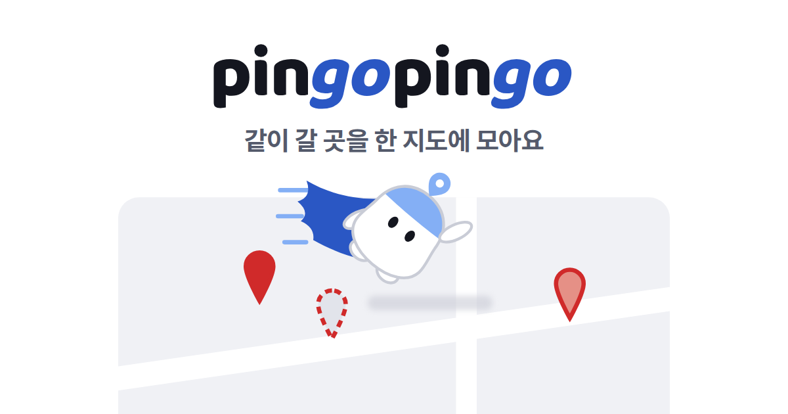
</p>

# 핑고핑고 (pin-go-pin-go)

카카오테크 캠퍼스 4기 2단계 팀 프로젝트, 충남대 2팀 "효정 없는 효정 팀"입니다.

| 서비스 | 주소 |
|---|---|
| 운영 | https://ktc-pingopingo.duckdns.org |
| 스테이징 | https://staging.ktc-pingopingo.duckdns.org |

**목차**: [소개](#프로젝트-소개) · [서비스 흐름](#1-서비스-흐름) · [주요 기능](#2-주요-기능과-설명) · [아키텍처](#3-아키텍처-설계) · [기술 스택](#4-기술-스택) · [실행 방법](#5-로컬-실행-방법) · [배포 방법](#6-배포-방법) · [폴더 구조](#7-폴더-구조) · [Git 컨벤션](#git-컨벤션) · [역할](#역할-구성)

## 프로젝트 소개

핑고핑고는 친구들과 같이 쓰는 여행 지도입니다. 가고 싶은 곳을 지도에 모으고, 의견을 나누고, 날짜별 동선까지 한 곳에서 정할 수 있게 만들었습니다. 의견이 갈려서 정하기가 멈추면 펭귄 마스코트 "핑고"(AI)가 먼저 알려 주고, 반대한 이유를 보고 다른 후보를 찾아 줍니다.

### 왜 만들었나

저희가 친구들끼리 여행을 계획해 보면 장소는 단톡방에 링크로 쌓이고, 저장은 지도 앱에, 일정은 메모장에 따로 적게 됐습니다. 제일 답답했던 건 누가 "거기 별로야"라고 한 다음이었습니다. 아무도 다른 곳을 안 내놓으면 얘기가 거기서 멈추고, 그 대화는 단톡방 위로 금방 묻혀 버렸습니다.

그래서 장소 고르기부터 날짜별 동선까지를 한 서비스에서 이어지게 하고, 제일 자주 막히는 "반대 다음"을 푸는 데 AI를 쓰기로 했습니다. 다루는 범위는 "어디를 가서 어떤 순서로 돌지"까지입니다. 항공·숙소 예약이나 경비 정산은 넣지 않았습니다. 방학마다 3~5명이 여행을 가는 대학생을 생각하고 만들었습니다.

---

## 1. 서비스 흐름

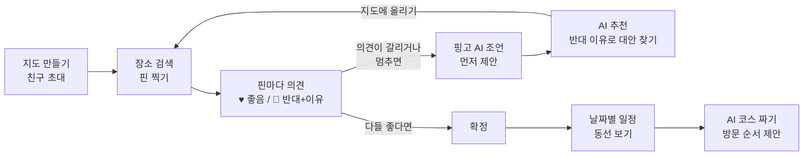

1. **지도 만들기**: 카카오나 구글로 로그인하고 여행지와 날짜를 넣으면 지도가 생깁니다. 초대 링크를 단톡방에 보내면 친구들이 같은 지도로 들어옵니다.
2. **핀 찍기**: 가고 싶은 곳을 검색해서 핀으로 찍습니다. 누가 핀을 찍거나 의견을 바꾸면 다른 사람 화면에도 바로 반영됩니다.
3. **의견 남기기**: 핀마다 ♥나 🚫를 누릅니다. 🚫는 이유를 적어야 등록됩니다.
4. **핑고 AI 조언**: 의견이 갈렸거나 반대 뒤로 아무도 움직이지 않으면, 따로 부르지 않아도 핑고가 제안 카드를 띄웁니다. 카드에 있는 버튼으로 바로 다음 행동을 할 수 있습니다.
5. **AI 추천**: "추천 받기"를 누르면 반대 이유를 반영한 대안이 근거와 같이 나옵니다. 마음에 들면 "지도에 올리기"를 눌러 다른 사람에게도 보이게 합니다.
6. **확정과 동선**: 가기로 한 곳을 확정하고 날짜별 일정에 넣은 다음, "동선 보기"로 그날 이동을 지도에서 봅니다.
7. **AI 코스**: "코스 짜기"를 누르면 휴무일과 이동 거리를 고려한 날짜별 방문 순서를 받아 볼 수 있습니다. 원하는 게 있으면 한 줄로 적어도 됩니다.

<table>
  <tr>
    <td align="center" width="50%">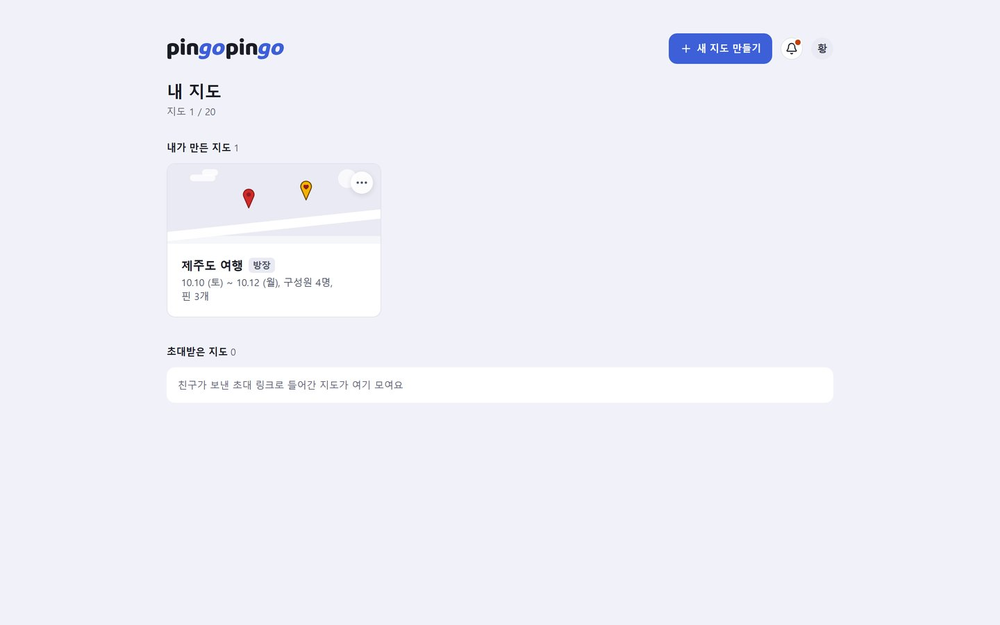<br/>1. 내 지도</td>
    <td align="center" width="50%">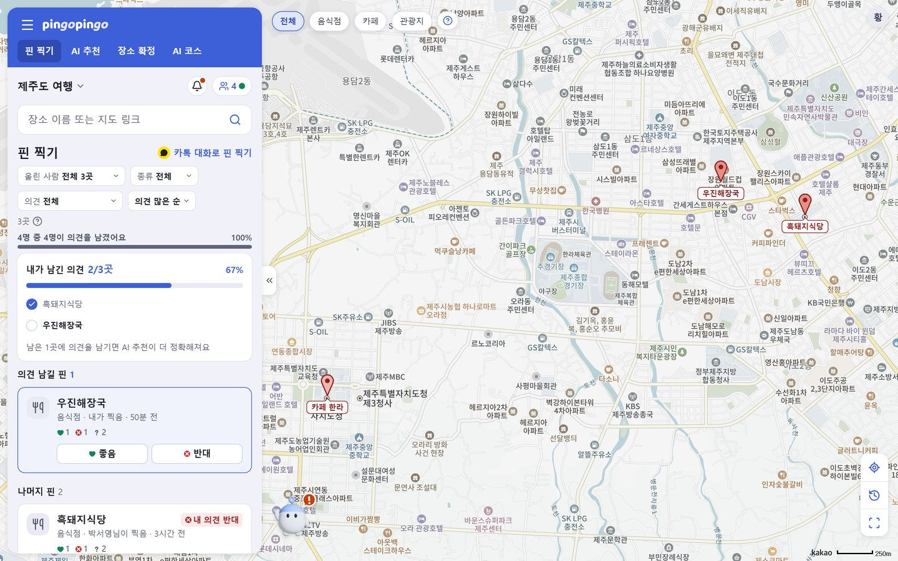<br/>2. 공동 지도와 핀 찍기</td>
  </tr>
  <tr>
    <td align="center">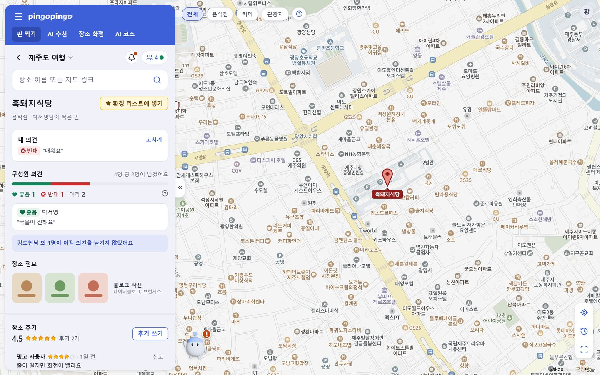<br/>3. 핀과 의견</td>
    <td align="center">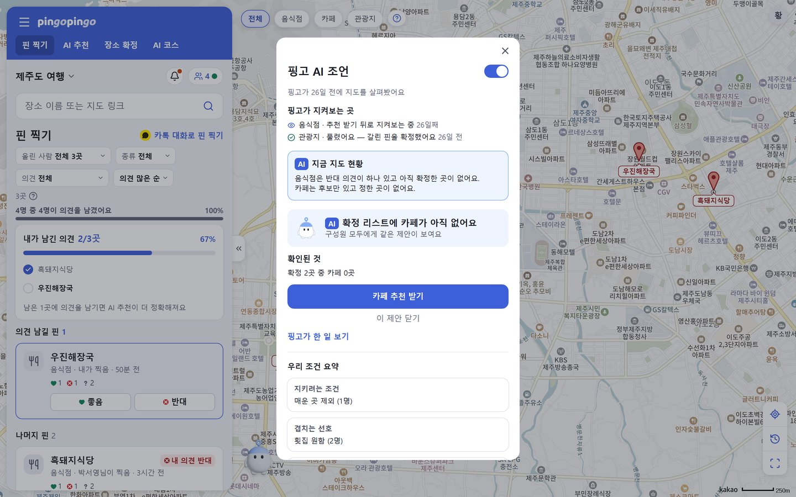<br/>4. 핑고 AI 조언</td>
  </tr>
  <tr>
    <td align="center">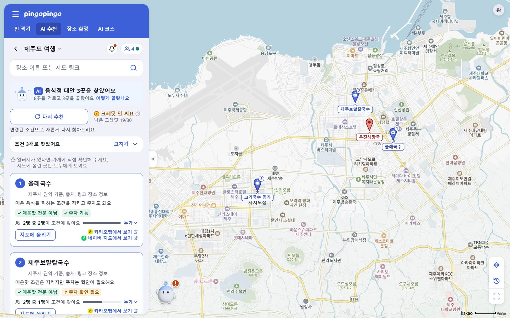<br/>5. AI 추천</td>
    <td align="center">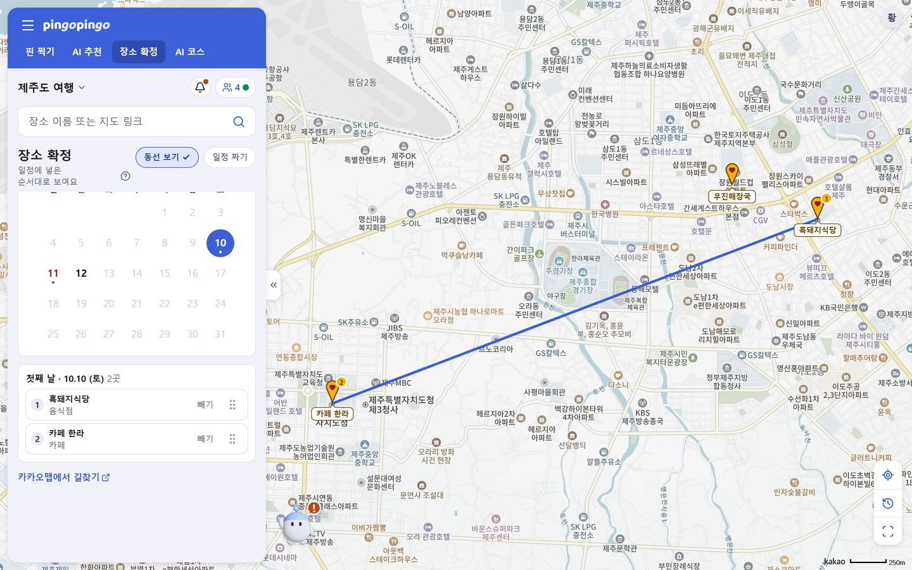<br/>6. 확정과 동선 보기</td>
  </tr>
  <tr>
    <td align="center">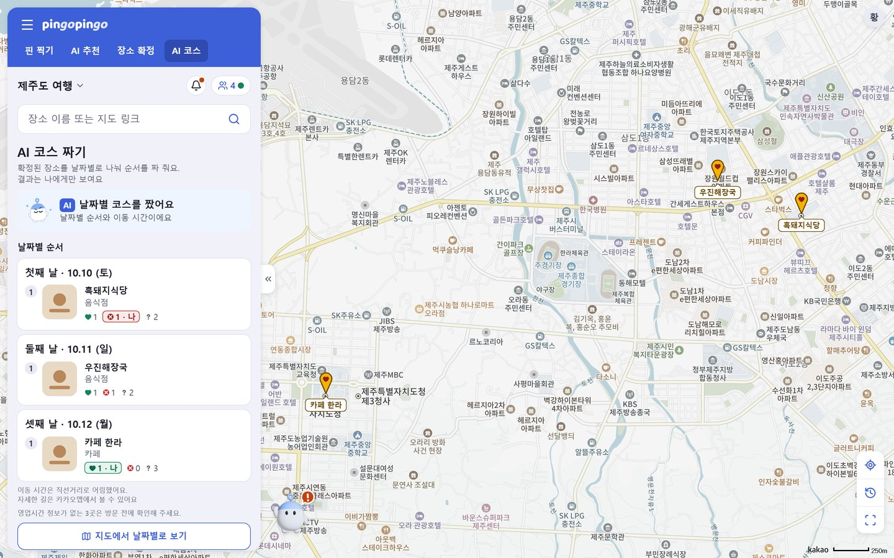<br/>7. AI 코스</td>
    <td></td>
  </tr>
</table>

스크린샷은 노트북 화면(1440×900)에서 개발용 목 서버의 예시 지도(제주도 여행, 4명)로 찍었습니다. 모바일에서는 같은 내용이 지도 아래쪽 시트로 열립니다. 장면별로 더 자세한 설명은 [`시연시나리오.md`](시연시나리오.md)에 있습니다.

---

## 2. 주요 기능과 설명

| 기능 | 설명 | AI 사용 |
|---|---|---|
| **공동 여행 지도** | 지도를 만들고 초대 링크로 친구를 부릅니다(게스트로도 참여 가능). 검색해서 핀을 찍고, 바뀐 내용은 SSE로 다른 사람 화면에도 바로 반영됩니다. 지금 같이 보고 있는 사람도 표시됩니다 | 없음 |
| **의견과 이유** | 핀마다 ♥ 좋음이나 🚫 반대를 남깁니다. 반대는 이유(칩이나 140자 이내 글)가 있어야 하고, 사람들이 말한 조건은 카테고리별 "우리 조건 요약"에 모입니다 | 반대 이유 글을 조건으로 바꿀 때 |
| **AI 추천** | 반대 이유를 조건으로 바꿔서 저희 장소 DB에서 대안 3곳을 찾습니다. 대안마다 추천 이유, 조건별 충족 여부, 몇 명의 조건에 맞는지, 출처를 같이 보여 줍니다. 요청한 사람에게만 보이고, "지도에 올리기"를 눌러야 다른 사람도 봅니다 | 조건 해석 1번, 거르기와 순위는 코드 |
| **핑고 AI 조언** | 서버가 5분마다 지도를 보고 멈춘 곳(반대 뒤 정체, 의견 갈림, 의견 안 남긴 핀, 비어 있는 카테고리, 일정 문제)을 찾습니다. 원인을 조사하고 검증을 통과한 제안만 카드로 띄우고, 수락한 뒤에도 해결됐는지 계속 지켜봅니다. 지도 전체 상황은 "지금 지도 현황" 한 문단으로 정리해 줍니다 | 진단 에이전트 |
| **확정과 일정** | 확정한 장소를 날짜별로 나누고, "동선 보기"로 그날 이동을 지도에서 봅니다. 날짜와 순서는 사람이 직접 정합니다 | 없음 |
| **AI 코스 짜기** | 확정한 장소로 날짜별 방문 순서를 짜 줍니다. "둘째 날은 여유롭게" 같은 요청을 목표로 바꾸고, 휴무와 이동 거리를 지키는 순서는 코드 최적화로 찾습니다. 결과는 요청한 사람에게만 보입니다 | 목표 세우기, 지휘 에이전트 |
| **그 밖에** | 카톡 대화에서 장소 가져오기, 크레딧(AI 추천·코스 1번에 1)과 장소 후기, 다크 모드가 있습니다. 장소 DB는 서울과 대전·춘천·광주·대구·부산입니다 | 없음 |

### AI는 어디까지 맡기나

처음에는 챗봇처럼 모델에게 다 맡겨 봤습니다. 그런데 꼭 지켜야 하는 조건이 있는 6건을 돌려 보니 6건이 다 틀렸습니다. "해산물 못 먹음"이라고 했는데 초밥집을 추천하는 식이었습니다. 그래서 한 명이라도 걸리면 안 되는 거르기, 순위, 거리와 동선 계산은 코드로 하고, 모델에게는 사람이 쓴 말 읽기, 막힌 원인 진단, 요청을 목표로 바꾸기처럼 정답이 하나로 안 떨어지는 일만 맡겼습니다.

- 모델이 하던 일 중 평가해 보니 코드가 더 나은 것(선호 순위, 에이전트 신호 순위, 추천 막힘 조언)은 코드로 옮겼습니다. AI 코스도 처음에는 모델이 장소를 직접 옮겼는데, 네 번 고쳐도 코드로 짠 기준선보다 못해서 계산은 코드에 넘겼습니다.
- 모델이 쓴 문장은 그대로 내보내지 않습니다. 문장에 나온 숫자와 인용은 코드가 실제 지도 데이터와 맞춰 보고(7단계 검증), 웹에서 찾은 정보는 출처가 진짜 검색 결과에 있었는지 확인한 뒤 "확인되지 않음"을 붙여서 보여 줍니다.
- 품질은 평가셋을 만들어서 쟀습니다. 에이전트 진단은 지도 상황 40개를 5번씩, AI 코스는 평가용 지도 24개를 3번씩 돌렸고, 틀린 이유와 고친 내용을 같이 기록했습니다([`docs/agent-v2.md`](docs/agent-v2.md) 21절, [`qa/results/`](qa/results/)).

> [!IMPORTANT]
> **AI에 대해 저희가 정한 규칙**
> - AI가 지도를 직접 바꾸지 않습니다. 제안은 버튼으로만 주고, 공개하거나 확정하는 건 사람이 합니다.
> - AI가 추천하는 장소는 저희 장소 DB에 있는 곳뿐입니다. 맞는 곳이 없으면 없다고 보여 줍니다.
> - 이유 없는 반대는 등록되지 않고, AI가 조건을 마음대로 느슨하게 바꾸지 않습니다. 반경을 넓히는 것도 사람이 합니다.
> - 모르는 건 모른다고 합니다. 알러지처럼 데이터로 확인할 수 없는 조건은 판단하지 않고, 가게에 직접 확인하라고 안내합니다.
>
> 전체 규칙 10개와 각 규칙을 지키는 코드 위치는 [`최종기술문서.md`](최종기술문서.md) 3.2절에 정리해 뒀습니다.

---

## 3. 아키텍처 설계

전체 구조부터 보고, 서버 안 모듈, 요청 하나가 처리되는 순서, AI가 들어가는 부분, 배포 구성 순서로 설명하겠습니다.

### ① 전체 구조

<p align="center">
  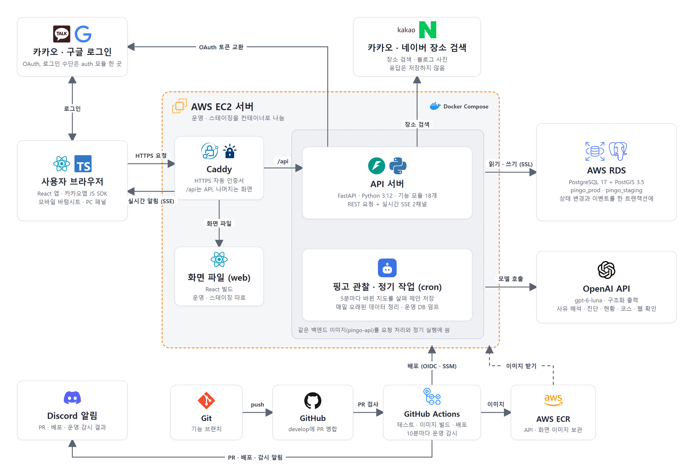
</p>

- 프론트와 백엔드 사이의 요청과 응답은 전부 [`docs/api-spec.yaml`](docs/api-spec.yaml)(OpenAPI 3.1) 하나에 정해 두었습니다. 프론트 타입과 목 서버를 이 파일로 만들어서, 프론트는 백엔드가 완성되기 전에도 작업할 수 있었습니다. 실제 응답이 스펙과 맞는지는 CI에서 확인합니다.
- 팀 인원과 서버 1대라는 조건을 생각해서 서버를 여러 개로 쪼개지 않고 FastAPI 앱 하나로 만들었습니다. 대신 안에서 기능별 모듈 18개로 나눴습니다(②).
- 실시간 반영은 SSE로 하고 채널을 두 개로 나눴습니다. 지도 구성원 모두가 받는 전체 채널과 본인만 받는 개인 채널입니다. AI 추천 대안은 요청한 사람에게만 보여야 해서 개인 채널로만 보냅니다.

### ② 서버 안 모듈

<p align="center">
  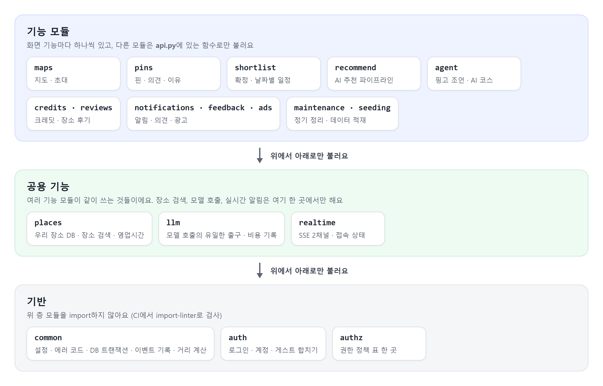
</p>

- 위 층이 아래 층을 부르고, 반대 방향은 막았습니다. 기반 모듈(`common`, `auth`, `authz`)은 기능 모듈을 import하지 않고, 이 규칙은 CI에서 import-linter로 검사합니다(`backend/pyproject.toml`).
- 다른 모듈을 쓸 때는 그 모듈의 `api.py`에 있는 함수만 부르고, 안쪽 파일(`service.py`, `models.py`)은 직접 가져오지 않습니다.
- 같은 규칙을 여러 곳에 따로 만들지 않으려고 했습니다. 권한은 `authz` 정책 표, 거리와 반경은 `common/geo.py`, 조건 목록은 `docs/constraints.md` 표, 모델 호출은 `llm` 모듈에서만 정합니다. 전체 목록은 [`CLAUDE.md`](CLAUDE.md)의 "한 곳이어야 하는 것" 표에 있습니다.

### ③ 요청 하나가 처리되는 순서 (반대를 남겼을 때)

<p align="center">
  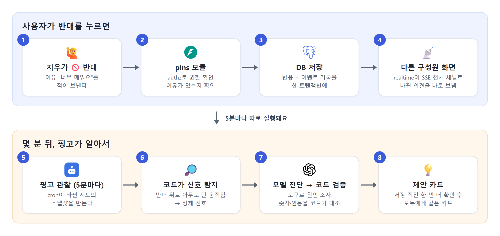
</p>

- 반응을 저장할 때 이벤트 기록도 같은 트랜잭션에서 남깁니다. 그래서 저장은 됐는데 다른 사람에게 알림이 안 가는 경우가 생기지 않습니다. 연결이 끊겼던 화면은 마지막으로 받은 이벤트 번호부터 다시 받습니다.
- 핑고는 사용자 요청과 따로 돕니다. 서버 cron이 5분마다 바뀐 지도를 살펴보고, 제안을 저장하기 바로 전에 상황을 한 번 더 확인해서 그사이 바뀌었으면 내지 않습니다.

### ④ AI가 들어가는 부분

| 기능 | 코드가 하는 일 | 모델이 하는 일 |
|---|---|---|
| AI 추천 | 실격 조건 거르기, 순위, 반경·거리, 근거 칩 | 반대 이유 글을 조건과 방향으로 해석(1번) |
| 핑고 AI 조언 | 멈춘 곳 찾기, 순위, 중복·횟수 제한, 해결 여부 판단, 숫자 확인, 저장 전 재확인 | 원인 진단(유형마다 정해진 도구를 최대 5번 사용), 문장 초안, 말할지 말지 결정 |
| 지금 지도 현황 | 카테고리별 숫자 계산, 먼저 볼 곳 결정 | 숫자를 보고 2~4문장으로 정리 |
| AI 코스 짜기 | 휴무·이동 최적화, 후보 비교, 문장 검증 | 요청을 목표로 바꾸기, 최적화를 어떻게 돌릴지 지휘(최대 5턴) |

모델 호출은 전부 `llm` 모듈을 거치고, 호출할 때마다 사용량과 비용을 기록합니다. 하루 예산을 넘으면 웹 확인 기능은 꺼집니다. 사용자가 직접 누르는 AI 기능(추천 받기, 코스 짜기)은 크레딧을 쓰고, 결과 없이 끝나면 크레딧을 돌려줍니다.

### ⑤ 배포 구성

①의 그림에서 아래쪽이 배포 흐름이고, 가운데 주황색 점선이 서버 한 대입니다.

- 운영과 스테이징을 서버 한 대에서 컨테이너, DB, 비밀값으로 나눠 돌립니다. 한 주소 안에서 `/api/*`는 API로, 나머지는 화면으로 보내서 세션 쿠키나 CORS 문제가 생기지 않게 했습니다.
- 서버에 AWS 키를 저장하지 않았습니다. GitHub Actions는 OIDC로 AWS에 접근하고, 서버 접속은 SSM으로만 해서 22번 포트도 열지 않았습니다.
- 운영 배포 전에 DB를 백업하고, 배포 후 상태 확인이 실패하면 이전 버전으로 자동으로 돌아갑니다. 서비스가 살아 있는지는 10분마다 밖에서 확인합니다.

모듈 경계와 DB 스키마는 [`docs/architecture.md`](docs/architecture.md), [`docs/data-model.md`](docs/data-model.md)에 더 자세히 적어 두었습니다.

---

## 4. 기술 스택

| 영역 | 기술 | 고른 이유 |
|---|---|---|
| 프론트엔드 | React 19, TypeScript, Vite, Tailwind CSS, TanStack Query(서버 상태), Zustand(화면 상태), 카카오맵 JS SDK | 모바일 위주 앱이라 가벼운 조합으로 골랐고, 서버 데이터와 화면 상태를 나눠서 실시간 갱신을 다루기 쉬웠습니다 |
| 백엔드 | Python 3.12, FastAPI, SQLAlchemy 2, Alembic, Pydantic | 데이터 처리와 모델 호출을 같은 언어로 할 수 있고, OpenAPI 스펙과 잘 맞습니다 |
| DB | PostgreSQL 17 + PostGIS 3.5 (AWS RDS) | 반경·거리 계산을 DB에서 바로 할 수 있고, RDS 자동 백업(7일)을 씁니다 |
| 실시간 | SSE(Server-Sent Events) 2채널 + `event_log` | 서버에서 화면으로 보내기만 하면 돼서 WebSocket보다 단순하고, 끊겨도 이벤트 번호로 이어서 받을 수 있습니다 |
| AI | OpenAI `gpt-6-luna`(구조화 출력), 웹 확인은 Responses API 웹 검색 | 출력 형식을 스키마로 고정할 수 있어서 코드로 검증하기 쉽습니다 |
| 계약 | OpenAPI 3.1 → openapi-typescript(FE 타입) · msw(목 서버) | 프론트가 백엔드 완성을 기다리지 않고 작업할 수 있습니다 |
| 테스트 | pytest(실제 PostgreSQL/PostGIS), Vitest, Playwright E2E, import-linter | DB를 가짜로 바꾸지 않고 운영과 같은 DB로 테스트합니다 |
| 인프라 | AWS EC2 · ECR · RDS · SSM, Docker Compose, Caddy, DuckDNS | 서버 한 대로 돌리기에 가장 단순한 구성이었습니다 |
| CI/CD | GitHub Actions(OIDC), 매일 스테이징 QA 하네스, 10분 외부 감시 | AWS 키를 저장해 두지 않고 배포합니다 |

버전과 근거 파일은 [`docs/tech-stack.md`](docs/tech-stack.md)에 있습니다.

---

## 5. 로컬 실행 방법

> [!TIP]
> 개발이 처음인 팀원도 따라 할 수 있게 쓴 설명서가 [`docs/team-setup-guide.md`](docs/team-setup-guide.md)에 있습니다. 아래는 짧게 줄인 버전입니다.

### 0. 준비

| 도구 | 버전 | 비고 |
|---|---|---|
| Python | 3.12 | 운영 이미지와 CI가 3.12입니다(`backend/.python-version`). 3.13 이상은 `psycopg2-binary`, `pyproj` 설치 파일이 없어 설치가 실패합니다 |
| Node | 22 (`.nvmrc`) | 프론트와 `contracts/` |
| Docker | 최신 | 로컬 DB(`postgis/postgis:17-3.5`, 운영·CI와 같은 이미지) |

환경변수 파일을 만듭니다.

```bash
cp backend/.env.example backend/.env
cp frontend/.env.example frontend/.env.local
```

> [!WARNING]
> `backend/.env`에 **`PINGO_ENV=dev`** 가 꼭 있어야 합니다. 이 값이 없으면 운영(prod)으로 인식해서 검사가 엄격해지고, 기본 `SESSION_SECRET`이나 개발용 스텁 모드로는 서버가 안 뜹니다.

실행 순서는 `1. DB → 2. BE (8000) → 3. FE (5173)`입니다.

### 1. DB (PostgreSQL + PostGIS)

```bash
cd backend
docker-compose up -d
```

### 2. BE (포트 8000)

```bash
cd backend
python -m venv .venv
.venv\Scripts\activate          # 맥/리눅스: source .venv/bin/activate
pip install -r requirements-dev.txt
alembic upgrade head            # DB가 떠 있어야 합니다
uvicorn main:asgi_app --reload
```

`http://localhost:8000/health`에서 `{"status":"ok"}`가 나오면 잘 뜬 겁니다. API 문서는 `http://localhost:8000/docs`에서 볼 수 있습니다.

> [!NOTE]
> 아래 값은 비어 있어도 서버는 뜹니다. 다만 해당 기능이 안 되거나 개발용 스텁으로 동작합니다.
>
> | 비어 있는 값 | 영향 | 해결 |
> |---|---|---|
> | `KAKAO_CLIENT_ID` · `KAKAO_CLIENT_SECRET` | 카카오 로그인 | 카카오 디벨로퍼스에서 앱을 만들고 리다이렉트 URI 등록 |
> | `GOOGLE_CLIENT_ID` · `GOOGLE_CLIENT_SECRET` | 구글 로그인(화면에는 "준비 중"으로 표시) | 구글 클라우드 콘솔 OAuth 클라이언트(웹) 발급 |
> | `KAKAO_REST_API_KEY` · `NAVER_SEARCH_*` | 실제 장소 검색(`PLACES_MODE=dev`면 스텁) | 키를 넣고 `PLACES_MODE=real` |
> | `ELICE_ML_API_KEY` | 모델 호출(`LLM_MODE=dev`면 스텁) | OpenAI 프로젝트 키를 넣고 `LLM_MODE=real` |
>
> AI 추천과 핑고 조언을 실제 장소로 돌려 보려면 장소 데이터를 먼저 넣어야 합니다([`docs/team-setup-guide.md`](docs/team-setup-guide.md) 5-4).

### 3. FE (포트 5173)

```bash
cd frontend
npm install
npm run dev
```

> [!IMPORTANT]
> - `frontend/.env.local`의 `VITE_API_BASE_URL`을 비워 두면 **msw 목 서버**로 돌아가서 백엔드 없이도 모든 화면을 볼 수 있습니다. 실제 백엔드에 붙이려면 `http://localhost:8000`을 넣으면 됩니다.
> - 지도를 띄우려면 `VITE_KAKAO_MAP_KEY`(카카오 JavaScript 키)가 필요하고, 카카오 앱 설정의 Web 플랫폼에 `http://localhost:5173`을 등록해야 합니다.

### 테스트

| 대상 | 명령 |
|---|---|
| 백엔드(실제 PostgreSQL/PostGIS 위에서, DB 모킹 없음) | `cd backend && pytest` |
| 프론트 | `cd frontend && npm test` |
| 계약 · 목 서버 | `cd contracts && npm test` |

---

## 6. 배포 방법

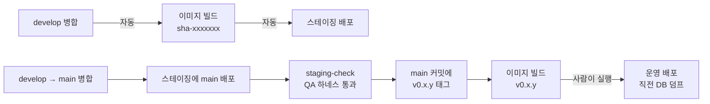

| 상황 | 하는 일 |
|---|---|
| **스테이징** | `develop`에 병합하면 `images.yml`이 이미지를 만들어 스테이징에 자동으로 올립니다 |
| **운영(릴리스)** | ① `develop` → `main` 병합 ② Actions `deploy`를 스테이징, `sha-<main 커밋 7자리>`로 실행 ③ Actions `staging-check`로 핵심 흐름 확인 ④ 통과한 `main` 커밋에 `v0.x.y` 태그 → 이미지 빌드 ⑤ Actions `deploy`를 운영, `v0.x.y`로 실행(배포 직전 DB 덤프) |
| **롤백** | Actions `deploy`를 운영, 이전 `v` 태그로 다시 실행합니다. 배포 후 상태 확인이 실패하면 `deploy.sh`가 알아서 이전 태그로 돌려 놓습니다 |
| **환경 변수** | 서버의 `deploy/env/<환경>.env`를 고치고 그 환경을 다시 배포합니다. 값은 저장소에 올리지 않습니다 |
| **DB 스키마** | 배포할 때 Alembic 마이그레이션이 자동으로 적용됩니다. 칼럼 추가와 삭제는 다른 릴리스로 나눠서, 배포 중이나 롤백한 뒤에도 이전 버전 코드가 문제없이 돌게 했습니다 |

배포 구성을 왜 이렇게 정했는지, 서버 처음 세팅, 데이터 적재, 예약 작업은 [`deploy_rules.md`](deploy_rules.md)에 정리해 두었습니다.

---

## 7. 폴더 구조

```
ktc4-chungnam-2/
├── .github/              # 이슈 · PR 템플릿, 워크플로(테스트 · 이미지 · 배포 · 감시 · 알림)
├── backend/              # FastAPI 앱 하나, 기능 모듈 18개
│   ├── auth/ authz/      # 로그인 · 계정 / 권한 정책 표
│   ├── maps/ pins/       # 공동 지도 · 초대 / 핀 · 반응 · 사유
│   ├── places/           # 우리 장소 DB · 장소 검색 · 영업시간
│   ├── recommend/        # AI 추천 파이프라인(실격 거르기 · 순위)
│   ├── llm/              # 모델 호출 한 곳(프롬프트 · 검증 · 비용 기록)
│   ├── agent/            # 핑고 AI 조언, agent/course/ 는 AI 코스 짜기
│   ├── shortlist/        # 확정한 장소 · 날짜별 일정
│   ├── realtime/         # SSE 이벤트 · 접속 상태
│   ├── credits/ reviews/ # 크레딧 · 장소 후기
│   ├── notifications/ feedback/ ads/ maintenance/ seeding/ common/
│   ├── integration/      # 모듈을 넘는 통합 · 계약 테스트
│   └── alembic/          # DB 마이그레이션
├── frontend/
│   └── src/
│       ├── features/     # 화면 기능 단위(map · recommend · agent · course · shortlist …)
│       ├── ui/           # 디자인 부품
│       └── styles/       # 색 토큰
├── contracts/            # api-spec.yaml에서 만든 FE 타입 · 목 서버(msw)
├── e2e/                  # Playwright E2E(실제 백엔드, 브라우저 2개)
├── qa/                   # 출시 전 점검 대장 · 하네스 · 결과
├── deploy/               # Compose · Caddy · 배포 스크립트 · cron
└── docs/                 # 계약(api-spec) · 아키텍처 · 데이터 모델 · 조건 표 · 에이전트 명세
```

---

## 품질

- 백엔드 테스트(pytest) 약 4,200개를 CI에서 실제 PostgreSQL/PostGIS로 돌립니다.
- 통합·계약 테스트로 스펙에 있는 API가 다 구현됐는지, 응답이 스펙과 같은지, 권한 표와 에러 코드 목록이 코드와 맞는지 확인합니다.
- 프론트는 Vitest, 그리고 실제 백엔드에 브라우저 2개를 띄워 실시간 반영까지 보는 Playwright E2E를 PR마다 돌립니다.
- 스테이징에서는 매일 QA 스크립트가 실제 요청으로 핵심 흐름을 확인합니다. 출시 전에 점검한 항목은 [`qa/cases.yaml`](qa/cases.yaml)에 있습니다.

## 문서

| 알고 싶은 것 | 문서 |
|---|---|
| 기술 전체 요약(아키텍처, 에이전트, 가드레일, 테스트, 지표, API) | [`최종기술문서.md`](최종기술문서.md) |
| 시연 장면과 그때 서비스가 하는 일 | [`시연시나리오.md`](시연시나리오.md) |
| 제품 스펙과 결정 이력 | [`최종기획안.md`](최종기획안.md) |
| API 계약 / 변경 이력 | [`docs/api-spec.yaml`](docs/api-spec.yaml) / [`docs/CHANGELOG-api.md`](docs/CHANGELOG-api.md) |
| 모듈 경계, DB 스키마, 조건 표 | [`docs/architecture.md`](docs/architecture.md), [`docs/data-model.md`](docs/data-model.md), [`docs/constraints.md`](docs/constraints.md) |
| 에이전트 명세와 평가 | [`docs/agent-v2.md`](docs/agent-v2.md) |
| 배포 절차 | [`deploy_rules.md`](deploy_rules.md) |
| 팀 규칙(모든 사람과 Claude Code 공통) | [`CLAUDE.md`](CLAUDE.md) |

### 직군별 문서

| 구분 | 파일 위치 |
|---|---|
| 백엔드 | [`backend/CLAUDE.md`](backend/CLAUDE.md), 모듈마다 `backend/<모듈>/CLAUDE.md` |
| 프론트엔드 | [`frontend/CLAUDE.md`](frontend/CLAUDE.md), 화면 규칙 [`frontend/DESIGN.md`](frontend/DESIGN.md) |
| 계약 · 목 서버 | [`contracts/README.md`](contracts/README.md), [`docs/openapi-workflow.md`](docs/openapi-workflow.md) |
| AI | [`docs/agent-v2.md`](docs/agent-v2.md), [`backend/llm/`](backend/llm/) |
| 인프라 | [`deploy_rules.md`](deploy_rules.md), [`docs/tech-stack.md`](docs/tech-stack.md) |
| QA | [`qa/README.md`](qa/README.md) |

## Git 컨벤션

작업은 항상 이슈를 먼저 만들고 시작했고, 브랜치·커밋·PR에 이슈 번호를 붙여서 서로 찾아갈 수 있게 했습니다.

| 위치 | 형식 | 예 |
|---|---|---|
| 브랜치 | `타입/주제-이슈번호` | `fix/status-first-card-1749` |
| 커밋 메시지 | `타입(범위): 요약 (#이슈번호)` | `fix(agent): 현황 문단의 먼저 볼 곳을 제안 카드와 어긋나지 않게 (#1749)` |
| PR 제목 | 커밋 메시지와 같은 형식 | `fix(agent): 현황 문단의 먼저 볼 곳을 제안 카드와 어긋나지 않게 (#1749)` |

| 타입 | 쓰는 때 |
|---|---|
| `feat` | 기능 추가 |
| `fix` | 버그 수정 |
| `ai` | 프롬프트 · 평가셋 · 모델 품질 |
| `docs` | 문서 |
| `test` | 테스트 추가 · 수정 |
| `refactor` · `chore` · `ci` | 동작을 바꾸지 않는 구조 개선, 설정 · 의존성 · CI |

- 브랜치 타입은 `feat`, `fix`, `ai`, `docs`를 씁니다. 범위에는 백엔드 모듈 이름(`agent`, `maps`, `recommend` 등)이나 `frontend`, `contracts`, `qa`, `deploy`처럼 고친 곳을 적습니다.
- `develop`에서 브랜치를 따서 `develop`으로 PR을 보냅니다. `main`은 릴리스용이고, `v` 태그를 단 버전만 운영에 올립니다.
- PR 본문에는 새로 생긴 개념, 덜어낸 것, 바뀐 결정이나 규칙을 적고, PR은 기능 단위로 작게 나눴습니다.

### 코드 리뷰 기준

저희는 코드 작성에 AI 도구를 많이 써서, 리뷰할 때는 코드 스타일보다 아래 항목을 중심으로 봤습니다. 자세한 기준은 [`docs/code-quality.md`](docs/code-quality.md)에 있습니다.

- 요청받은 범위만 건드렸는가
- API 스펙과 실제 응답이 일치하는가
- 실격 조건이나 가드레일 같은 도메인 규칙을 지켰는가
- 테스트가 진짜 실패 케이스를 잡는가, 통과만 하도록 짜였는가
- 에러를 조용히 삼키지 않는가
- PR 설명에 "왜 이렇게 했는지"가 있는가

## 역할 구성

| 역할 | 담당 |
|---|---|
| PM | 황준영 |
| 백엔드 | 김민재 |
| 프론트엔드 | 장현성, 표강준 |
| AI | 김관호, 황준영 |
| 데이터 | 김도윤 |
