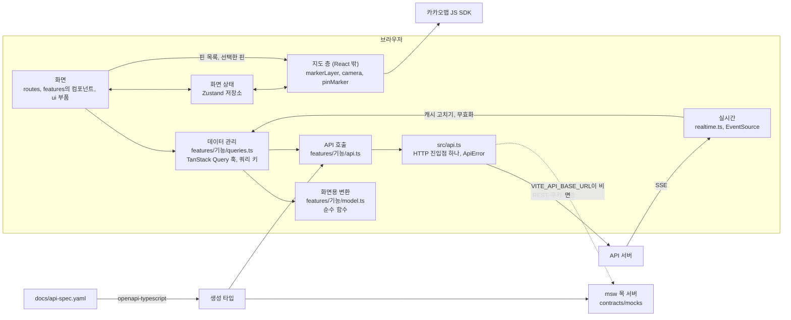
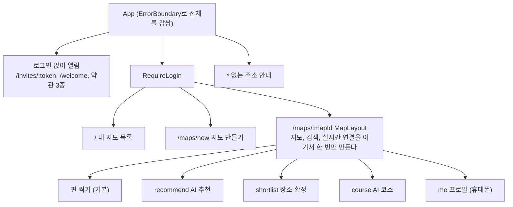
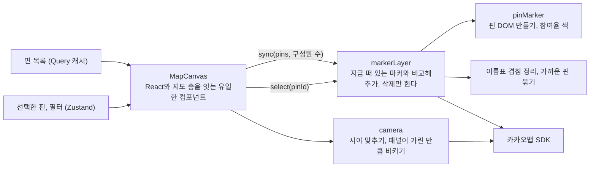
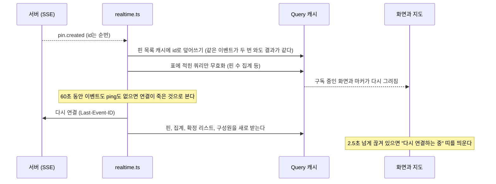
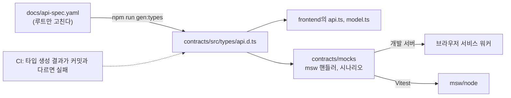
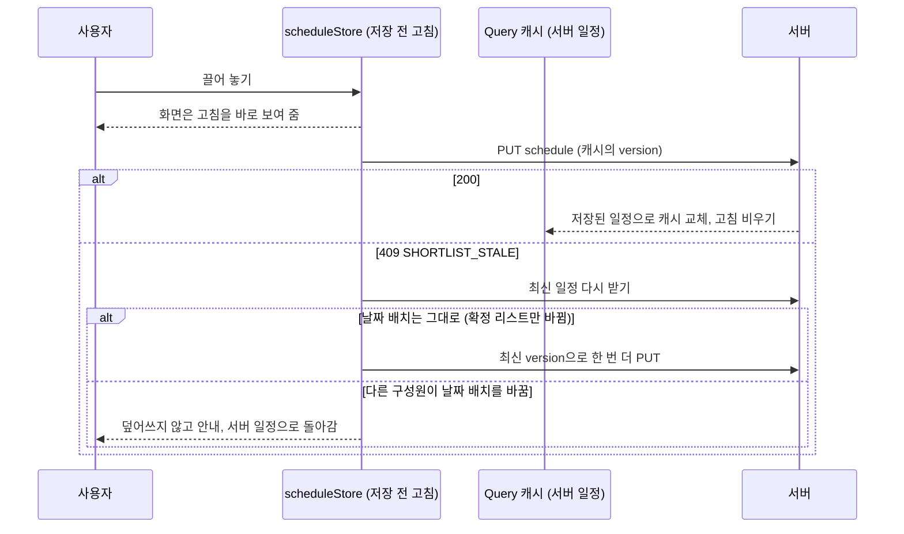
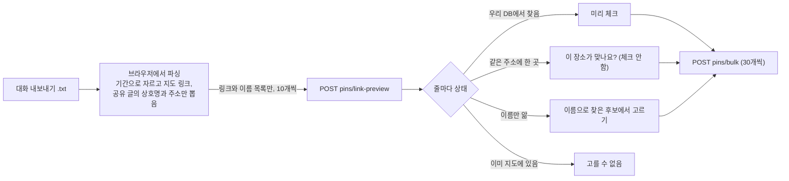
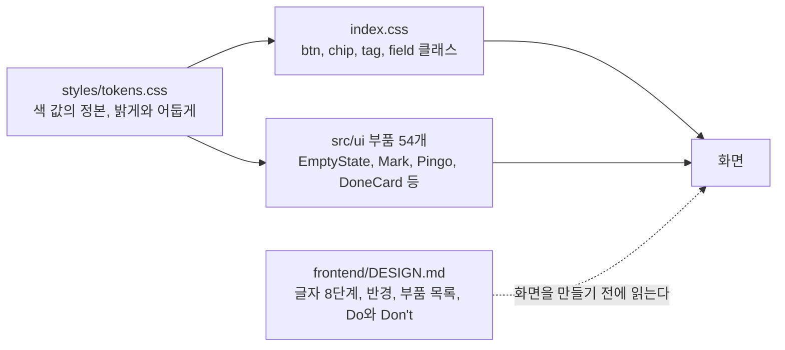

# 프론트엔드 설계

작성 2026-11-11, 장현성(프론트엔드 리드). 수치는 2026-11-11 develop 기준이다.

이 문서는 `최종기술문서.md`의 프론트엔드 편이다. 화면 쪽 설계를 왜 그렇게 정했는지를 중심으로 적었다. 서버와 주고받는 모양은 `최종기술문서.md` 6절에, 화면 규칙의 정본은 `frontend/DESIGN.md`와 `docs/design/colors.md`에 있다.

## 1. 배경과 문제

프론트엔드가 풀어야 했던 문제는 네 가지다.

1. **지도가 화면의 주인공이다.** 핀 찍기, 추천, 확정, 코스가 모두 같은 지도 위에서 일어난다. 그런데 카카오맵 JS SDK는 명령형 API이고 공식 React 래퍼도 없다. 핀 수백 개를 React 상태로 그리면 지도를 끌 때마다 핀을 다시 그린다.
2. **여러 명이 동시에 쓴다.** 다른 구성원이 남긴 핀과 의견은 새로고침 없이 내 화면에 떠야 한다. 연결이 끊겼다 다시 붙어도 화면과 서버가 어긋나면 안 된다.
3. **백엔드보다 화면을 먼저 만들어야 했다.** 9월 중순 프론트를 시작할 때 서버에는 모듈이 4개뿐이었다. 서버를 기다렸다면 5주짜리 v1 일정을 맞추지 못했다.
4. **프론트 담당이 두 명이고, 코드 대부분을 Claude Code와 함께 썼다.** AI가 화면마다 버튼 높이와 색을 그때그때 정하면 화면이 제각각이 된다. AI가 사람이 정한 규칙을 매번 읽고 따르도록 할 장치가 필요했다.

## 2. 목표와 하지 않기로 한 것

### 목표

| 목표 | 확인 방법 |
| --- | --- |
| 지도는 항상 떠 있고, 탭을 바꿔도 지도를 다시 만들지 않는다 | 지도 화면 틀(`MapLayout`) 하나 아래에 탭 5개가 자식 경로로 붙는다 |
| 서버 없이 모든 화면을 개발하고 시험한다 | 환경 변수 `VITE_API_BASE_URL`을 비우면 목 서버가 켜진다 |
| 서버 응답 모양이 바뀌면 컴파일에서 걸린다 | 타입은 `docs/api-spec.yaml`에서 생성한다. CI에서 타입 검사와 빌드는 필수다 |
| 실패를 조용히 넘기지 않는다 | 오류는 `ApiError` 하나로 올리고, 화면은 오류 코드로 분기한다. 저장에 실패하면 토스트로 알린다 |
| 휴대폰이 주 환경이고 PC는 같은 내용을 다른 틀에 담는다 | 탭 내용 컴포넌트는 한 벌이고, 틀만 바텀시트와 왼쪽 패널 두 가지다 |
| WCAG 2.2 AA, 터치 영역 44×44px | 접근성 시험(`a11y.test.tsx`)과 디자인 규칙 문서 |

### 하지 않기로 한 것

| 항목 | 이유 |
| --- | --- |
| PC 전용 화면 | 화면을 두 벌 두면 기능 하나를 고칠 때마다 두 곳을 손대야 하니 틀만 바꾼다 |
| 서버 사이드 렌더링(Next.js 등) | 로그인해야 쓰는 지도 앱이라 검색에 노출될 필요가 없다. 예외는 초대 링크 미리보기 하나인데, Caddy가 메신저 봇의 요청만 API로 보내서 풀었다 |
| 전역 `services`, `repositories` 층 | 기능 폴더마다 파일 3개면 충분했다. 여러 기능에서 같은 코드가 되풀이되면 그때 공통으로 뽑는다 |
| 구성원별 핀 색 | 5명이 모두 다른 색을 받을 확률이 낮다. 게다가 색을 배정하는 규칙에 강퇴 뒤 색을 다시 쓰는 규칙까지 붙는다(9절 참고) |
| 네이티브 앱, 오프라인 저장 | 초대받은 사람이 웹 링크 하나로 바로 들어와야 한다 |
| 화면이 권한을 스스로 판정하기 | 방장인지는 화면이 따지지 않는다. 버튼을 보일지는 응답의 `permissions`로 정한다 |

## 3. 기술 선택과 고려한 대안

| 영역 | 선택 | 고려한 대안 | 선택한 이유와 트레이드오프 |
| --- | --- | --- | --- |
| 빌드, 프레임워크 | Vite 8 + React 19 + TypeScript 6, 정적 파일로 배포 | Next.js | 서버 렌더링이 필요 없고, 정적 파일이라 Caddy 컨테이너 하나면 된다. 대신 스크립트를 다 받아야 첫 화면이 그려진다 |
| 서버 상태 | TanStack Query 5 | Redux, 직접 `useEffect`로 받기 | 캐시, 다시 받기, 무효화를 이미 갖추고 있다. 실시간 이벤트가 오면 캐시만 고쳐도 화면이 따라온다 |
| 화면 상태 | Zustand 5 (저장소 11개, 기능 폴더 안에 둔다) | React Context, Redux | 지도 컨트롤러처럼 React 바깥 코드도 값을 읽고 써야 하는데, Context는 컴포넌트 안에서만 읽힌다 |
| 지도 | 카카오맵 JS SDK를 직접 다루는 마커 층 | React 래퍼 라이브러리(비공식), 네이버 지도, 구글 지도 | 장소 검색과 좌표가 카카오 기준이고, 국내 장소는 카카오가 가장 잘 맞는다. 비공식 래퍼로는 핀 겹침 정리와 이름표 배치를 우리가 손댈 수 없었다 |
| 실시간 | SSE(`EventSource`) | WebSocket, 주기적 폴링 | 서버로 보내는 일은 REST로 충분하고, 실시간 쪽은 받기만 하면 된다. 재연결과 `Last-Event-ID`는 브라우저가 알아서 처리한다 |
| 스타일 | Tailwind CSS 4 + 색 토큰(`tokens.css`) + shadcn/ui(Radix) | CSS-in-JS, 컴포넌트 라이브러리(MUI 등) | 토큰 한 곳에서 색과 반경을 바꾸면 화면 전체가 바뀐다. 모달 포커스 가두기 같은 접근성 동작은 Radix가 맡는다. MUI는 지도 앱의 바텀시트 모양과 맞지 않았다 |
| 서버 흉내 | msw 목 서버(`contracts/mocks`) | JSON 파일 고정 응답, 서버가 될 때까지 기다리기 | 브라우저의 실제 `fetch`를 가로채서, 화면 코드는 상대가 목인지 실서버인지 모른다. 결과 0곳, 잔액 부족 같은 시나리오를 바꿔 가며 볼 수 있다 |
| 화면 시험 | Vitest + Testing Library, Playwright | Cypress, 스냅샷 시험 | 단위 시험이 빌드 도구와 같은 Vite 위에서 돈다. 스냅샷은 문구 하나만 바뀌어도 깨져서 쓰지 않았다 |
| 린트 | oxlint | ESLint | 빨라서 골랐다. 규칙 수가 적은 부분은 빌드에 든 타입 검사(`tsc -b`)가 메운다 |

## 4. 구조

### 4.1 전체 그림

먼저 바깥에서 본 그림이다. 사용자는 초대 링크로 들어온다. 브라우저 안에서는 React 앱 하나가 카카오맵 SDK, 우리 서버 두 곳과 주고받는다. 별표를 붙인 곳은 뒤에서 절을 따로 두어 설명한다.

같은 구조를 코드 층으로 나누면 아래와 같다. 화면은 훅만 부르고, 서버로 나가는 요청은 모두 `src/api.ts`를 거친다.

### 4.2 화면 틀

지도는 항상 화면 전체에 깔려 있고, 탭은 그 위에 뜬 시트의 내용만 바꾼다.

- 바텀시트는 접힘, 절반, 전체 3단계다. 탭마다 마지막 단계를 기억하므로 탭을 오가도 시트가 튀지 않는다.
- 핀 상세는 주소(URL) 없이 시트 안에서 열린다. 절반 단계에서 내용을 끌어 올리면 시트가 전체 단계로 넓어지고 의견 쓰기가 나온다.
- 넓은 화면은 같은 탭 내용 컴포넌트를 왼쪽 패널에 담는다. `useIsDesktop`으로 나누는 것은 끌기 동작 끄기처럼 CSS만으로 안 되는 차이뿐이다.

경로는 아래와 같다. `RequireLogin` 밖에는 로그인 없이 여는 화면(초대 수락, 약관, 서비스 안내)만 둔다.

### 4.3 데이터 흐름 3단

기능 폴더(`src/features/` 아래 18개)마다 같은 이름의 파일 세 개를 둔다.

| 층 | 파일 | 하는 일 | 모르는 것 |
| --- | --- | --- | --- |
| API 호출 | `api.ts` | 엔드포인트 함수(`fetchPins`, `createMap`)에 경로, 메서드, 본문을 담는다 | React, TanStack Query |
| 데이터 관리 | `queries.ts` | `use~Query`, `use~Mutation` 훅, 쿼리 키 팩토리, 무효화 | 화면 모양 |
| 화면용 변환 | `model.ts` | 서버 응답을 화면용 값으로 바꾸는 순수 함수(참여율, 기간 문자열, 핀 종류) | 네트워크 |
| 화면 | `routes/`, 컴포넌트 | 훅만 부른다 | 엔드포인트 경로 |

- 네트워크 훅은 이름이 `Query`나 `Mutation`으로 끝난다. 이름만 봐도 서버를 부르는 훅인지, `usePinSelection` 같은 화면 상태 훅인지 구분된다.
- 쿼리 키는 기능마다 팩토리 하나(`pinKeys.list(mapId)`)에 모았다. 다른 기능에서 무효화할 때도 이 팩토리를 가져다 쓴다.
- 분기가 있는 로직은 `model.ts`의 순수 함수로 모았다. 단위 시험이 가장 많이 붙은 곳도 여기다.

**왜 이렇게 나눴나.** 처음에는 페이지 컴포넌트에서 `useQuery`와 `api()`를 바로 불렀다. 쿼리 키 문자열은 파일마다 흩어졌고, 같은 타입 선언이 세 파일에 따로 있었다. 멘토가 3주 내리 "API, 데이터 관리, 화면 사이 층이 보이게 하라"고 지적해서(PR #94, #118, #152) 10월 초에 지금 구조로 옮겼다(#284, PR #286). 전역 공통 층을 새로 설계하는 안도 있었다. 하지만 프론트 인원이 두 명이라 기능 폴더 안 파일 3개로 끝냈다.

### 4.4 상태를 어디에 두는가

같은 값은 한 곳에만 둔다.

| 값의 종류 | 두는 곳 | 예 |
| --- | --- | --- |
| 서버가 정본인 값 | TanStack Query 캐시 | 핀 목록, 구성원, 확정 리스트, 일정, 크레딧 잔액 |
| 이 화면에서만 의미 있는 값 | Zustand 저장소 | 시트 단계, 왼쪽 패널 열림, 고른 추천 후보, 검색어, 아직 저장하지 않은 일정 고침 |
| 이 기기에 남길 값 | localStorage | 화면 모드(밝게, 어둡게), 최근 검색어, 안내를 본 횟수 |
| 지도 SDK 객체 | React 밖 지도 층 | 마커 DOM, 카메라 위치, 이름표 배치 |
| 주소에 담을 값 | URL | 어느 지도, 어느 탭 |

인증 토큰은 프론트가 들고 있지 않는다. 세션은 HttpOnly 쿠키로 유지하고, 요청은 모두 `src/api.ts` 한 곳에서 `credentials: 'include'`를 달고 나간다.

### 4.5 지도 층

카카오맵은 React 바깥에서 따로 다룬다. React가 넘기는 것은 핀 목록과 선택한 핀뿐이고, SDK는 지도 층이 맡는다.

- `sync`는 목록 전체를 다시 그리지 않고 바뀐 만큼만 반영한다. 실시간으로 핀 하나가 들어오면 마커도 하나만 새로 생긴다.
- 핀 색은 CSS `color-mix(in oklch, ...)`로 만든다. 의견을 남긴 사람 수를 전체 구성원 수로 나누고, 그 비율만큼 회색에서 빨강 쪽으로 섞는다.
- 화면 좌표로 24px보다 가까운 핀끼리는 숫자 핀 하나로 묶고, 확대하면 다시 푼다. 이름표는 중요한 것부터 놓고, 겹치면 숨긴다.
- 마크업 주입을 막으려고 장소 이름은 `innerHTML`이 아니라 속성과 텍스트로만 넣는다.

**트레이드오프.** 지도 층은 React 개발 도구로 들여다볼 수 없다. 호출 순서를 잘못 잡으면 마커가 지워지지 않고 남는 버그도 생긴다. 그래서 겹침 정리, 묶기, 카메라 계산은 SDK 없이 도는 순수 함수로 떼어 내 시험한다(`markerLayer.test.ts`, `camera.test.ts`).

### 4.6 실시간

지도에 들어오면 `MapLayout`이 전체 채널(`GET /maps/{mapId}/events`)에 연결을 하나 연다. 탭을 옮겨도 이 연결은 끊지 않는다.

- 이벤트마다 무엇을 다시 받을지는 표 하나(`refetchTable`)에 적었다. `docs/events.md`의 표를 그대로 옮겼으므로, 이벤트를 더할 때는 이 표와 문서를 같이 고친다.
- 서버는 이벤트를 최소 한 번(at-least-once) 보내므로 반영은 모두 멱등이다. 핀은 id로 덮어쓰고, 반응은 집계를 통째로 덮는다.
- 노트북이 절전에서 깨거나 Wi-Fi가 바뀌면, 브라우저는 연결이 끊긴 줄 모르고 계속 기다린다. 그래서 서버가 20초마다 ping을 보내고, 화면은 60초 동안 아무것도 받지 못하면 스스로 다시 붙는다(#832).
- 비공개 AI 후보는 전체 채널로 오지 않는다. 요청한 사람이 `GET /runs/{runId}/result`로 직접 받고, 지금 보고 있는 추천은 화면 저장소(`aiStore`)에 둔다.
- AI 코스는 실행이 최대 180초까지 걸려서, SSE가 아니라 `course-runs`를 주기적으로 물어보고, 작업 기록이 쌓이는 대로 보여 준다.

### 4.7 스펙에서 타입과 목 서버까지

- 스펙은 프론트가 직접 고치지 않는다. 모자라거나 틀린 곳이 보이면 루트에 이슈로 올린다.
- 개발 화면과 단위 시험은 목 서버의 같은 핸들러를 쓴다. 개발하는 동안에는 시나리오 전환기(`ScenarioSwitcher`)로 결과 0곳, 잔액 부족 같은 상황을 바로 띄워 본다.
- 운영 빌드에는 msw가 없다. `import.meta.env.DEV`일 때만 동적으로 불러오므로 번들에서 잘려 나간다.

## 5. 주요 흐름

### 5.1 일정 고치기 (먼저 보여 주고 뒤에 저장)

확정 탭에서 장소를 날짜 칸으로 끌어 놓으면 화면이 바로 바뀌고, 저장은 그 뒤에 한다.

서버는 `version`을 확정 항목 전체로 계산하므로, 누가 장소를 확정하기만 해도 값이 바뀐다. 처음에는 409가 오면 전부 "다른 구성원이 먼저 바꿨어요"로 안내했고, 혼자 쓰는 지도에서도 이 문구가 떴다. E2E 시나리오를 늘리다가 찾았다(#1436). 날짜 배치가 실제로 바뀌었을 때만 남이 고친 것으로 보도록 고쳤다.

### 5.2 카톡 대화로 핀 찍기 (원문은 브라우저 밖으로 나가지 않는다)

대화 원문과 참여자 이름은 서버로 보내지 않는다. 이 약속은 화면 구조가 지킨다. 파싱은 브라우저에서 끝나고, 서버로 가는 요청 본문에는 링크와 상호명, 주소만 담는다. 확실하지 않은 짝은 미리 체크하지 않고 사람이 고른다.

### 5.3 오류 처리

| 상황 | 화면 동작 |
| --- | --- |
| 서버가 오류 봉투(`code`, `message`, `detail`)를 줌 | 분기는 HTTP 상태가 아니라 `code`로 한다. 같은 409를 `NOT_READY`와 `PIN_DUPLICATE`가 함께 쓰기 때문이다. 문구는 `docs/errors.md`에 적힌 화면 문구를 쓴다 |
| 상한, 기간 같은 숫자 | 숫자는 화면에 적어 두지 않는다. 응답의 `detail`이나 목록 응답 값으로 채운다 |
| 배포 중 프록시가 502, 503, 504를 줌 | 조회(GET)만 1, 2, 4, 8, 16초 간격으로 다시 묻는다. 쓰기는 서버에 닿았는지 알 수 없으니 다시 보내지 않는다 |
| 쓰기 실패 | 토스트로 알리고, 먼저 보여 준 고침은 서버 값으로 되돌린다 |
| 컴포넌트에서 예외 | 흰 화면 대신 앱 전체를 감싼 `ErrorBoundary`가 안내를 띄운다. 주소가 바뀌면 오류를 비운다 |
| 실시간 연결 끊김 | 2.5초가 지나면 "다시 연결하는 중" 띠를 띄우고, 브라우저가 포기하면 "다시 연결" 버튼을 보여 준다 |
| 카카오맵 SDK를 못 받음 | 키가 빠진 경우와 지도를 못 그린 경우를 따로 안내한다. 실패를 기억해 두지 않으므로 새로고침하지 않아도 다시 시도한다 |
| 없는 주소 | 안내 화면을 띄운다(#1677). 그전에는 빈 화면이 나왔다 |

## 6. 디자인 체계

AI와 함께 코드를 써도 화면이 제각각이 되지 않도록 이 체계를 두었다.

- **색은 토큰만 쓴다.** 값의 정본은 `tokens.css`다. 왜 그 색으로 정했는지는 문서(`docs/design/colors.md`)에 적는다.
- **화면보다 부품을 먼저 만든다.** 화면 안에서 클래스를 새로 짜지 않는다. 맞는 부품이 없으면 부품과 문서부터 만들고, 화면은 그 부품으로 조립한다.
- **핀 색은 한 가지 뜻만 담는다.** 지도 위 핀은 빨강으로 고정하고, 의견을 남긴 사람의 비율만큼 진해진다. 확정 핀만 골드를 쓴다. 브랜드 파랑은 카카오맵의 물 색과 같은 대역이라, 핀에 쓰면 강과 바다 위에서 묻힌다.
- **AI에는 따로 색을 주지 않았다.** AI가 만든 것은 형태(핑고 핀)와 "AI" 배지, 옅은 바탕 톤으로 구분한다. 보라색을 따로 쓰는 안은 접었다. 파랑과 43도 차이라 영역이 갈리지 않았다.
- **색만으로 뜻을 전하지 않는다.** 반응은 기호와 색, 숫자를 함께 보여 준다. 이모지는 OS마다 모양이 달라서, 기호는 직접 그린 `ui/Mark` 하나로 통일했다(#1340).
- **다크 모드.** `<html data-theme>` 값 하나에 따라 토큰 묶음이 바뀐다. 카카오맵 SDK는 어두운 지도를 주지 않아서, 지도 타일 이미지에만 CSS 필터를 걸고, 핀과 오버레이는 그대로 둔다(#1412).

## 7. 테스트와 CI

| 종류 | 규모 | 무엇을 보나 |
| --- | --- | --- |
| 화면 단위(Vitest, Testing Library) | 시험 파일 93개, 케이스 495개 | `model.ts` 순수 함수, 화면 흐름(누르고 입력하고 기다리기), 접근성(시트 제목 포커스, 알림 영역) |
| 목 서버(contracts) | 케이스 185개 | 목 서버가 스펙대로 답하는지, 옛 필드를 화면이 아직 쓰는지 |
| 브라우저 E2E(Playwright) | 시나리오 3개 | 실제 백엔드와 DB로 지도 만들기부터 "지도에 올리기"까지(브라우저 2개로 실시간 확인), AI 코스와 크레딧 |

- PR이 올라오면 `frontend` 검사가 oxlint, Vitest, 빌드(타입 검사 포함) 순서로 돈다. `develop`의 필수 검사여서 실패하면 병합할 수 없다. 멘토가 "빌드가 되는지 PR마다 확인하라"고 지적해서 넣었다(#310).
- 시간이나 실행 순서에 따라 결과가 달라지는 시험은 쓰지 않는다. 커버리지를 채우려고 스펙을 그대로 베낀 시험도 마찬가지다.
- E2E가 실패해도 시험에 "응답 기다리기" 우회를 넣지 않는다. 한 번 넣은 적이 있는데, 화면의 저장 순서 버그를 고친 뒤 뺐다. 지금 시험은 사용자와 같은 경로로 지나간다.

화면은 정적 파일로 배포한다. `frontend/Dockerfile`이 빌드 결과를 Caddy 이미지에 담고, API 주소는 같은 호스트의 `/api`로 고정한다. 카카오 지도 JS 키는 브라우저에 그대로 드러나므로 카카오 콘솔에서 사이트 도메인으로 제한한다.

## 8. 처음 설계에서 바뀐 것

| 항목 | 처음 | 지금 | 바꾼 이유 |
| --- | --- | --- | --- |
| 데이터 받기 | 페이지 안에서 `useQuery`, `api()` 직접 호출 | 기능 폴더의 `api.ts`, `queries.ts`, `model.ts` 3단 | 로직을 바꿀 때마다 화면 코드까지 고쳐야 했다. 멘토 리뷰에서 3회 지적받았다(#284) |
| 로그인 시작 | 화면이 카카오 인가 주소를 직접 만듦 | 서버의 `/auth/kakao/login`으로 이동 | 화면이 만든 주소에 `state`가 없어서 실제 서버 콜백이 요청을 거절했다(#283) |
| 하단 탭 | 3개(핀, AI 추천, 확정) | 4개 + 휴대폰 프로필 탭 | AI 코스를 확정 탭의 시트에서 꺼내 탭으로 뺐다(11-02). 코스를 바로 열어 볼 수 있게 하고, 에이전트가 일하는 모습을 서비스 앞쪽에 드러내고 싶었다. 휴대폰에서는 알림과 계정을 아래 프로필 탭으로 옮겼다(#1660). 둘 다 프로필과 가장 가까운 기능이고, 그 자리는 화면 오른쪽 위보다 엄지가 닿기 쉽다 |
| 추천 순서 | 근거 확인 화면을 거친 뒤 결과 | 결과부터 보여 주고 결과 화면에서 조건을 고쳐 다시 추천 | 모델은 "추천 받기"를 누르는 순간 사유를 조건으로 바꾼다. 근거 확인 화면만 보고 나가도 모델 비용은 이미 나간 뒤였다. 순서를 바꿔 낸 비용이 늘 결과로 이어지게 하고, 단계도 하나 줄였다(#845) |
| AI 후보 핀 | 빨강 점선 핀 | 파랑 핑고 핀, 지도에 올리면 일반 핀과 같은 모양 | 점선은 작은 핀에서 잘 안 보였다. 지도에 올린 뒤에도 남의 핀처럼 보였다(#843, #1032) |
| 확정 핀 색 | 검정 | 골드 + 갈색 윤곽선 | 검정은 지도 위에서 무거웠고 서비스가 어두워 보였다. 브랜드 파랑을 쓰면 화면이 파랑 일색이 됐다(#149) |
| 구성원별 핀 색 | 제안자마다 다른 색 | 색 하나, 진하기가 참여율 | 5명이 모두 다른 색을 받을 확률은 3.8%였고, 배정 규칙도 과했다. 누가 찍었는지는 핀 상세와 필터에서 보인다(#26) |
| 반응 | 좋음, 조율 필요, 반대 | 좋음, 반대, 미확인 | 의견이 갈렸다면 그 자체로 조율이 필요한 상태다. 따로 둔 버튼은 뜻이 모호했다(#360) |
| 동선 | 서버가 순서를 계산해 내려 줌 | 사람이 정한 일정 순서대로 화면이 선과 번호를 그림 | 사람이 정한 순서를 서버가 바꾸면 안 된다. 자동 순서는 AI 코스로 떼어 냈다(#1171) |
| PC 화면 | 없음(모바일 화면이 그대로 늘어남) | 왼쪽 패널. 처음엔 화면을 나눈 고정 패널, 지금은 지도 위에 뜬 카드 | 바텀시트가 가로 1920px를 덮었다. 고정 패널은 접어도 자리를 차지해서, 지도 앱에서 흔히 하듯 지도 위에 띄웠다(#338, #1538) |
| 색 체계 | shadcn 기본 팔레트(검정 버튼)와 우리 토큰이 공존 | 토큰 하나, shadcn 이름은 토큰에 매핑 | 10-03 디자인 점검 때 보니 화면 절반이 검정 버튼이었다 |
| 글꼴 | Geist(한글 없음, OS 글꼴로 대체됨) | Pretendard | 기기마다 한글 모양이 달랐다(#290) |
| 화면 기호 | 이모지 글자(♥, 🚫) | 직접 그린 `ui/Mark` | 이모지는 OS마다 모양이 다르고 화면에서 튄다(#1340) |
| 핑고의 자리 | AI가 말하는 자리에만 | 서비스의 안내자(빈 화면, 로딩에도). AI 표시는 배지가 맡는다 | 디자이너 시안은 로딩과 오류에도 핑고를 썼다. 그쪽이 서비스 성격에 맞았다(#634) |
| 다크 모드 | v1 범위 밖 | 구현(기기 설정을 따르고 설정에서 고정) | 필수 기능은 아니었고 내가 원해서 넣었다. 밝은 화면이 눈에 부담스러운 사람에게는 어두운 화면이 편하다. 색이 이미 토큰 구조여서 묶음 하나만 더하면 됐다(#1412) |
| 완료 효과 | 컨페티(#1723) | 뺌 | 일정을 다 채운 순간에 성취감을 주려고 넣었다. 그런데 차분하게 의견을 맞추는 서비스와는 어울리지 않았다(#1754) |

**돌아보면.** 하단 탭은 3개에서 4개로, 다시 5개로 두 번 바뀌었다. 다시 설계한다면 탭을 늘리고 줄이고 합치는 일이 생긴다고 보고 처음부터 그에 맞춰 짜겠다.

## 9. 트레이드오프

- **지도를 React 밖에서 다룬다.** 성능과 통제를 얻은 대신 React의 선언적 모델을 쓰지 못하고, 개발 도구로 지도 층을 볼 수도 없다. 그래서 계산은 순수 함수로 떼어 시험한다.
- **핀 색 하나에 참여율을 담았다.** 화면은 단순해졌다. 다만 1/4과 2/4는 나란히 놓고 봐야 구분된다. 그래서 핀 상세 맨 위에는 "2/4명이 의견을 남겼어요"를 꼭 글로 넣는다.
- **목 서버로 먼저 만들었다.** 서버를 기다리지 않았지만, 목 서버와 실제 서버가 어긋날 위험은 남는다. 타입은 스펙에서 생성하고, 그 틈은 서버 쪽 응답 모양 시험과 E2E가 살핀다. 그래도 저장 순서 같은 타이밍 문제는 E2E를 늘리고 나서야 드러났다.
- **먼저 보여 주고 뒤에 저장한다(일정).** 끌어 놓으면 화면이 곧바로 반응하지만, 저장 실패와 충돌 처리가 복잡해졌다. 이 방식은 일정 한 곳에만 쓴다. 다른 쓰기는 응답을 기다린 뒤 캐시를 고친다.
- **추천 run을 화면이 들고 있다.** 서버에는 "내 추천 목록"이 없어서, 새로고침하면 보고 있던 추천이 사라진다. 요청자에게만 보이는 데이터여서 받아들였다. 이어 보기가 필요해지면 run id를 sessionStorage에 둔다.
- **PC는 틀만 바꾼다.** PC 전용 배치(넓은 표, 여러 칸)는 쓰지 못하지만, 화면 코드는 한 벌만 관리한다.
- **요청 제한과 접속 상태는 서버 한 대를 전제한다.** 화면은 이 전제에 기대지 않고 응답만 따른다.

## 10. AI 도구 활용

프론트 코드는 대부분 Claude Code와 함께 썼다. `frontend/`를 건드린 커밋 798개 중 625개가 내 계정이고, 그중 363개에는 Claude가 공동 작성자로 올라 있다. 아래에 무엇을 맡기고 무엇을 내가 정했는지 적는다.

### 10.1 쓴 도구

| 도구 | 쓴 곳 |
| --- | --- |
| Claude Code | 구현, 시험 작성, 버그 원인 조사, PR과 이슈 본문 초안, 화면 캡처 비교 자료 |
| Impeccable 스킬 | `DESIGN.md`와 `PRODUCT.md`에 맞춘 화면 점검(10-03 첫 점검 11/20점, P1 5건은 이슈로 올림) |
| Figma 에이전트, Figma MCP | 화면 초안 작성과 코드 반영 |
| 저장소 스킬(`structure-review`, `pr-summary`) | 같은 문제를 여러 방식으로 푼 곳 찾기, 담당자 전달 요약 |
| Playwright(헤드리스 캡처) | 바꾸기 전과 후의 화면을 나란히 띄워 놓고 내가 고르기 |

### 10.2 맡긴 것과 내가 정한 것

| 구분 | 내용 |
| --- | --- |
| 내가 정한 것 | 화면 구조(지도 + 탭 + 시트), 색과 핀의 뜻, 용어, 무엇을 만들지 않을지, 여러 시안 중 어느 것을 고를지, 병합 여부 |
| AI에 맡긴 것 | 정한 구조 안의 구현, 시험 코드, 반복 수정(부품으로 옮기기, 토큰 교체), 원인 조사(CI 기록, 화면 녹화 프레임 분석) |
| AI가 제안하고 내가 고른 것 | 색 시안, 자간과 행간 값, PC 패널 머리 모양, 핑고 그림의 방향 처리 |
| AI에 맡기지 않은 것 | 스펙(`docs/api-spec.yaml`) 수정, 다른 모듈 코드, 사용자 승인 없는 병합, 비밀값 다루기 |

### 10.3 AI가 규칙을 따르게 만든 장치

- **AI는 작업 전에 문서부터 읽는다.** `frontend/CLAUDE.md`에 스택, 화면 구조, 하지 말 것을 적었고, 화면을 만들기 전에 읽을 문서로 `DESIGN.md`를 정해 두었다. 세션이 바뀌어도 같은 규칙에서 시작한다.
- **부품부터 정의했다(10-17).** AI가 화면마다 버튼 높이와 반경을 그때그때 정하다 보니 버튼 높이가 4종, 태그 반경이 4종으로 늘었다. 부품 목록을 문서에 올리고 "목록에 없으면 부품부터 만든다"를 규칙으로 넣자 가짓수가 줄었다.
- **Figma 초안을 정답으로 두지 않았다(10-03).** AI가 Figma 초안을 그대로 옮기자 터치 영역이 작고 대비가 모자란 화면이 나왔다. 그 뒤로 AI는 더 나은 안이 있으면 "Figma는 X, 제안은 Y, 이유는 Z" 형식으로 먼저 말한다.
- **모양이 바뀌면 캡처부터 본다.** 모양이 바뀌는 작업은 전과 후의 캡처 비교를 먼저 받아 보고, 내가 승인해야 커밋한다.
- **검사는 기계에 맡겼다.** 필수 CI(oxlint, Vitest, 빌드)와 GitHub 글의 줄 길이를 검사하는 훅을 두었고, 세션마다 git worktree를 따로 쓴다.

### 10.4 AI의 결과를 내가 고치거나 반려한 사례

| 날짜 | AI가 한 것 | 내 판단 | 결과 |
| --- | --- | --- | --- |
| 09-29 | 스펙 설명 한 줄만 보고 "당일치기 여행이 되는지 애매하다"며 백엔드에 보낼 질문 글까지 씀 | DB 제약과 서버 코드는 이미 허용하고 있었다. 근거를 끝까지 확인한 뒤에 말하라고 했다 | "스펙 한 줄이 아니라 DB, 서버 코드, 최신 브랜치까지 본다"를 규칙으로 정함 |
| 09-29 | 프론트 작업 중 `docs/`와 `contracts/`를 직접 고쳐 PR에 넣음(#132) | 스펙의 정본은 루트다. PR을 닫고 루트에 보고하는 방식으로 바꿨다 | 프론트 세션은 스펙을 고치지 않는다. 변경 제안은 글로만 쓴다 |
| 10-19 | 시트 안 핑고를 3D로 그림 | 평면 화면에서 겉돌았다 | 시트 안은 평면 2D, 지도 위 버튼만 3D |
| 11-05 | 화면 기호를 lucide 아이콘으로 교체 | 선 굵기가 핑고, 핀과 달랐다. 우리 서비스에 맞게 그린 그림을 원했다 | `ui/Mark` 하나로 직접 그림. 반대 모양(채운 원에 X)도 내가 정했다 |
| 11-06 | 왼쪽으로 걷는 핑고를 CSS로 좌우 반전 | 빛 방향까지 같이 뒤집혀 그림자가 좌우로 바뀌었다 | 뒤집은 그림을 번갈아 쓰지 않는다. 원본 한 장과 기울기로 표현 |
| 11-08 | 색 시안 C(밝은 파랑, 차가운 회색)를 냄 | 다른 서비스(토스)와 너무 비슷했다 | 시안 D(핑고 하늘색과 이어지는 파랑, 라벤더 회색)로 결정(#1522) |
| 11-09 | PC 패널 머리 시안 세 가지 | 기존이 가장 낫다고 보고 모두 반려 | 기존 유지 |
| 11-06 | E2E가 실패하자 "응답 기다리기" 우회를 추가 | 고쳐야 할 것은 화면이었다 | 저장 순서 버그 2건을 고치고 우회를 뺌(#1436) |

반대 방향도 있었다. 내가 진행 막대를 빨강, 주황, 초록으로 하자고 하자, Claude는 "빨강은 핀, 반대, 되돌릴 수 없는 동작에만 쓴다"는 우리 규칙을 들어 다른 안을 냈다. 진행은 파랑으로 두고 완료만 초록으로 칠하는 안이었고, 그 안으로 갔다.

내가 내 판단을 뒤집은 적도 있다. 완료 순간의 컨페티는 성취감을 주려고 내가 요청해서 넣었다(11-10, #1723). 그런데 화면에서 보니 서비스의 결과 맞지 않아 다음 날 뺐다(#1754).

### 10.5 내가 이해하고 설명할 수 있게 한 방법

- 구조를 바꾸는 PR에는 층 그림과, 파일마다 어느 층에 속하는지 적은 표를 본문에 넣는다(멘토 요청).
- 큰 버그는 증상, 확인한 것, 원인, 조치, 결과 순서로 적어 둔다(`frontend/notes/portfolio-log.md`).
- 지도 대표 이미지, 블로그 사진, 초대 링크 미리보기는 서버 코드까지 고쳐야 해서, 백엔드 담당 민재님의 리뷰를 받은 뒤 병합했다.
- 결정은 이슈 번호와 함께 문서(`DESIGN.md`, `colors.md`)에 남긴다. 접은 안도 "폐기된 안" 표에 이유를 붙여 적어 두고, 같은 제안이 다시 나오면 그 표를 본다.

## 11. 기술적으로 어려웠던 것

구조 설명(4절, 5절)에서 다루지 못한 문제를 증상, 원인, 조치 순서로 적는다. 실시간 연결이 조용히 끊기는 문제는 4.6절, 일정 저장 충돌은 5.1절에서 다뤘다.

### 11.1 좌표를 저장할 수 없는 핀

우리 장소 DB에 없는 가게도 핀으로 찍을 수 있다(실시간 핀, #382). 하지만 카카오 약관 때문에 검색 응답의 이름과 좌표는 서버에 저장하지 못한다(#53). 그래서 서버에는 카카오 장소 ID, 검색어, 메모만 남는다.

마커를 그리려면 좌표가 필요하므로, 지도를 열 때마다 브라우저가 저장된 검색어로 카카오 키워드 검색을 다시 하고, 결과에서 장소 ID가 같은 곳의 좌표로 마커를 그린다. 찾은 좌표는 메모리에만 둔다. localStorage에도 Query 캐시에도 넣지 않는다(`features/map/livePlaces.ts`).

| 걸린 것 | 조치 |
| --- | --- |
| 실제 서버에서, 같은 검색어로 찾아도 정확도순 상위 45건에 그 장소가 빠지는 일이 있었다 | 먼저 지도에 있는 핀들의 중심에서 가까운 순으로 찾는다. 못 찾으면 기준 없이 한 번 더 찾는다(#387) |
| 좌표가 늦게 오면, 핀이 다 보이게 시야를 맞추는 동작이 사람이 옮겨 둔 지도를 끌고 갔다 | 손으로 끈 경우에 더해 내 위치, 검색 결과, 핀 고르기로 옮긴 경우도 사람이 움직인 것으로 센다. 그 뒤로는 시야를 맞추지 않는다(#1271) |
| 폐업하거나 이름이 바뀌어 끝내 못 찾는 장소가 있다 | 아직 찾는 중인 장소와 찾아봤지만 없는 장소를 서로 다른 상태로 나눈다. 1분 넘게 걸리면 다시 시도할지 묻는다(#1376) |

### 11.2 포털로 그린 모달이 뒤의 시트를 움직였다

- **증상.** 휴대폰 프로필 탭에서 알림함을 누르면 뒤의 바텀시트 단계가 바뀌었다. 알림함은 투명해진 채로 화면을 가로막았다.
- **원인.** 알림함은 포털이라 DOM에서는 시트 바깥에 그려지지만, React 트리에서는 시트 제목 줄의 자식이다. React 이벤트는 DOM이 아니라 React 트리를 따라 올라간다. 그래서 바텀시트는 알림함을 누른 것을 끌기로 여기고 포인터 캡처를 가져갔다. 캡처를 뺏긴 알림함은 닫힘 전환을 끝내지 못해서 닫힘 처리가 불리지 않았다.
- **조치.** 이제 바텀시트는 시트 DOM 안에서 일어난 이벤트만 끌기로 받는다. 모달은 닫을 때 끌던 값을 비우므로 닫힘 전환이 늘 끝난다(#1707).

### 11.3 누르는 순간 화면이 움직여 누름이 빗나갔다

- **증상.** 시트가 절반 단계일 때 버튼이 가끔 눌리지 않았다. E2E에서는 "반대" 누르기가 거듭 빗나갔다.
- **원인.** 입력칸이 키보드에 가리지 않도록 "시트 안에 포커스가 들어오면 전체 단계로 올린다"는 규칙이 있었다. 그런데 손가락이나 마우스로 버튼을 누르는 순간에도 포커스가 들어와 시트가 올라갔다. 손을 뗄 때는 버튼이 이미 다른 자리에 있어서 누름으로 잡히지 않았다.
- **조치.** 키보드로 옮긴 포커스와 입력칸(`:focus-visible`)일 때만 시트를 올린다(#1675).
- **남긴 것.** E2E가 가끔 실패하더라도 시험이 불안정한 탓으로 넘기지 않는다. 이번 건은 사용자가 실제로 겪는 버그였다.

### 11.4 사파리에서만 나는 끌기 문제

- **증상.** 팀원이 보낸 사파리 화면 녹화를 보면, 장소를 일정 칸으로 끄는 도중 화면 글자가 통째로 선택되고 넣어 둔 일정 4곳이 사라졌다. 팀은 이것을 끌기 기능의 버그 하나로 보았다.
- **확인.** 영상을 0.25초 단위 그림으로 잘라 보니, 글자가 선택되는 순간과 일정이 사라지는 순간이 달랐다. 일정이 사라질 때는 "일정을 저장하지 못했어요" 토스트가 떠 있었다.
- **원인.** 문제는 두 개였다. 하나는 사파리가 포인터로 끄는 동안 글자 선택을 막지 않는다는 점이다. 다른 하나는 끌기와 상관없는 서버 저장 실패였다. 일정이 사라진 것은 이 저장 실패 때문이고, 화면은 규칙대로 서버 값으로 돌아간 것이다.
- **조치.** 끄는 동안 `selectstart`를 막았다. 끌기 훅을 한 곳에 두었기 때문에 세 화면이 한꺼번에 고쳐졌다(#1434). 저장 실패는 따로 백엔드 이슈로 넘겼다(#1435).

### 11.5 배포 직후 깊은 주소에서 빈 화면

- **배경.** 스크립트 파일 이름에는 해시가 붙어서 빌드할 때마다 바뀐다. 그래서 스크립트는 1년 동안 캐시하고, 그 이름이 적힌 `index.html`은 매번 새로 확인하도록(`no-cache`) 둔다.
- **원인.** `no-cache`는 `/`에만 붙었고, `/maps/...` 같은 화면 주소로 받는 `index.html`에는 붙지 않았다. 게다가 `/assets`에 없는 파일을 요청하면 `index.html`을 200으로 돌려주면서 1년 캐시까지 붙이고 있었다. 옛 `index.html`이 지워진 스크립트를 요청하면, 스크립트 자리에 HTML이 1년 동안 남는다.
- **조치.** `/assets`는 있는 파일만 1년 캐시로 주고, 없는 파일에는 404를 준다. 나머지 주소는 모두 `no-cache`를 붙여 `index.html`을 준다. Caddy 설정은 컨테이너에서 응답 머리를 보며 시험했다(#168). 멘토 리뷰에서 지적을 받았고, 스테이징이 실제로 그렇게 응답하는 것을 확인한 뒤에 고쳤다.

### 11.6 같은 겹침 문제를 두 곳에서 풀고 있었다

AI 추천 탭에는 후보 핀과 지도 핀이 함께 뜬다. 후보 이름표와 지도 핀 이름표를 따로 정리하다 보니, 각자 안에서는 겹치지 않아도 서로를 덮었다. 같은 문제를 두 곳에서 풀었으니 둘 사이가 어긋났다. 지금은 후보를 지도 핀보다 앞 순서로 같은 정리에 넣어 한 번에 푼다(`markerLayer.setLeadLabels`, #1744).

## 12. 예상 질문과 측정

설계를 설명하다 보면 나올 질문을 미리 따져 봤다. 답이 코드에 있는 것, 재 본 것, 아직 답이 없는 것으로 나눴다.

### 12.1 코드에 답이 있는 것

| 질문 | 답 |
| --- | --- |
| 로그아웃하고 다른 계정으로 들어오면 앞 사람 데이터가 남지 않나 | 로그아웃, 탈퇴, 계정 전환 때 Query 캐시를 통째로 비운다(`features/auth/queries.ts`의 `queryClient.clear()`) |
| "추천 받기"를 두 번 누르면 크레딧이 두 번 빠지지 않나 | 요청마다 `Idempotency-Key`를 붙인다. 키와 본문이 같으면 서버는 같은 run을 돌려준다 |
| 일정을 빠르게 연달아 고치면 요청 순서가 꼬이지 않나 | 저장 요청을 한 줄로 세운다. 보내는 동안 더 고치면 앞 요청이 끝나기를 기다렸다가 마지막으로 고친 내용만 보낸다 |
| 장소 이름에 태그가 들어 있으면 지도 마커에서 실행되지 않나 | 마커의 `innerHTML`에는 우리가 쓴 고정 SVG만 들어간다. 이름은 속성과 `textContent`로만 넣는다 |
| 탭을 옮길 때마다 실시간 연결을 다시 맺나 | 지도 화면 틀에서 한 번만 맺는다. `navigate` 함수는 주소가 바뀔 때마다 새로 생기므로 ref에 담아 연결의 의존성에서 뺐다 |
| 직접 다시 연결하면 놓친 이벤트는 어떻게 되나 | `EventSource`를 새로 만들면 `Last-Event-ID`가 붙지 않는다. 그래서 이때는 이벤트 재전송에 기대지 않고 핀, 집계, 확정 리스트, 구성원을 REST로 다시 받는다 |
| 지도를 끄는 동안 매 프레임 이름표를 다시 계산하나 | 이름표는 움직임이 끝난 뒤(`idle`) 한 번만 정리한다. 핀 묶기는 확대 단계가 바뀔 때만 한다 |
| 쿠키 인증이면 CSRF는 어떻게 막나 | 쿠키는 SameSite=Lax다. 쓰기 요청은 모두 JSON 본문이어서 다른 사이트의 폼으로는 만들 수 없다. 화면과 API는 같은 출처(`/api`)를 쓴다. 로그인 CSRF는 서버의 `state` 쿠키가 막는다 |
| 운영 번들에 목 서버가 들어가나 | 개발 모드에서만 동적으로 불러오므로 운영 빌드 결과에는 msw 코드가 없다 |
| 지도를 브라우저 탭 여러 개에 띄우면 실시간 연결 수가 모자라지 않나 | HTTP/1.1에서는 한 출처에 연결을 6개까지만 열 수 있어 탭 6개에서 막힌다. 운영 서버는 HTTP/2로 응답하므로(2026-11-11 응답 머리로 확인) 연결 하나에 여러 흐름이 함께 실린다 |
| 화면이 버튼을 숨기면 권한이 지켜지나 | 아니다. 버튼을 숨기는 것은 편의이고 권한 판정은 서버의 `authz`가 한다. 화면은 응답의 `permissions`를 따르기만 한다 |

### 12.2 재 본 것 (2026-11-11, develop 운영 빌드)

**첫 진입 시간.** 처음 들어온 사람이 서비스 안내 화면을 보기까지 걸린 시간이다. 헤드리스 크롬에 휴대폰 크기 화면을 띄워 3회 잰 중앙값이다.

| 조건 | 시작 화면(HTML) | 스크립트 도착 | 안내 화면이 뜸 |
| --- | --- | --- | --- |
| 제한 없음 | 0.2초 | 0.1초 | 0.3초 |
| 빠른 4G(약 1.4Mbps, 지연 150ms) + CPU 4배 느리게 | 1.0초 | 3.7초 | 4.1초 |
| 느린 4G(400kbps, 지연 400ms) + CPU 4배 느리게 | 2.4초 | 12.8초 | 13.4초 |

- 첫 진입에 받는 양은 약 790KB다. 스크립트는 한 덩어리로 945KB(gzip 289KB), 스타일은 134KB(gzip 31KB)이고, 나머지는 글꼴 조각이다.
- 서버를 같은 컴퓨터에 띄워 쟀다. 실제 망에서 드는 TLS 연결과 DNS 시간이 빠져 있으니 실제로는 이보다 느리다.
- 판단: 와이파이와 보통 LTE에서는 문제가 없지만, 느린 망에서는 13초가 걸린다. 스크립트를 탭 단위로 나누지 않아서 안내 화면도 지도 화면에서만 쓰는 코드(추천, 코스, 카톡 가져오기)까지 함께 받는다. 알려진 한계에 올리고, 탭 단위 분할은 다음 작업으로 둔다.

**핀이 많을 때 이름표 정리.** 지도 움직임이 끝날 때마다 이름표 겹침을 한 번 정리하는데(`placeLabels`), 여기에 걸리는 시간을 쟀다. 카카오맵 SDK 없이 실제 마커 DOM을 화면에 무작위로 놓고 15회 잰 중앙값이다.

| 핀 수 | 휴대폰 화면 | 휴대폰, CPU 4배 느리게 | PC 화면 | PC, CPU 4배 느리게 |
| --- | --- | --- | --- | --- |
| 30 | 4ms | 17ms | 1ms | 4ms |
| 100 | 23ms | 151ms | 10ms | 40ms |
| 200 | 36ms | 174ms | 32ms | 76ms |
| 500 | 113ms | 414ms | 84ms | 318ms |
| 1,000 | 164ms | 914ms | 131ms | 719ms |

- 핀 묶기(`groupNear`)는 1,000개에서도 15ms(느린 CPU 59ms)로 문제없다.
- 판단: 지도 하나에 핀이 수십 개라고 보면 충분히 빠르다(30개일 때 느린 기기에서 17ms). 100개를 넘으면 느린 휴대폰에서 지도가 멈춘 직후 0.15초쯤 굼뜨다. 정리는 움직임이 끝날 때 한 번만 돌아서, 지도를 끄는 동작 자체는 느려지지 않는다.
- 원인: 이름표 하나마다 폭을 읽고(`offsetWidth`) 곧바로 보임 여부를 쓰기 때문에 브라우저가 이름표 수만큼 배치를 다시 계산한다. 폭을 모두 먼저 읽은 다음 한꺼번에 쓰면 배치 계산은 한 번으로 줄어든다. 핀 수 상한이 늘어나면 이렇게 고친다.
- 한계: 실제 화면에서는 겹쳐서 묶인 핀에 이름표가 붙지 않으므로 비용이 이보다 작다. 카카오맵이 마커를 옮기는 비용은 재지 않았다.

**시간대.** 기기 시간대를 바꿔 가며 화면 시험 전체(495개)를 돌렸다.

| 시간대 | 결과 |
| --- | --- |
| UTC(CI 환경) | 필수 검사라 PR마다 통과하고 있다(이번에 따로 돌리지는 않았다) |
| 키리티마티(UTC+14) | 495개 통과 |
| 로스앤젤레스(UTC-8) | 493개 통과, 2개 실패 |
| 파고파고(UTC-11) | 493개 통과, 같은 2개 실패 |

- 여행 날짜, 일정의 날짜 칸, 달력은 시간대와 상관없이 통과했다. 날짜는 날짜 문자열로만 다루고, 계산은 모두 UTC 기준으로 하기 때문이다. 해외에서 접속해도 여행 날짜가 하루 밀리지 않는다.
- 실패한 2개는 초대 링크 만료일 표시(`toInviteRowView`) 시험이다. 화면은 만료 시각을 기기의 현지 날짜로 보여 주는데, 시험은 기대값을 한국 날짜("11.7 (토)")로 적어 두었다. 화면은 의도대로 동작했고, 시험이 실행 환경의 시간대에 기대고 있었다. 시험 쪽에서 시간대를 고정해야 한다.
- 남은 판단: 만료일을 현지 날짜와 한국 날짜 중 무엇으로 보일지는 아직 정하지 않았다. 지금은 국내 여행만 다루므로 현지 날짜로 둔다.

### 12.3 아직 답이 없는 것

| 질문 | 지금 상태 |
| --- | --- |
| 다시 받는 도중에 이벤트가 오면 늦게 온 응답이 이벤트를 덮지 않나 | 반영은 멱등이다. 이벤트를 받으면 관련 쿼리를 무효화하므로 결국 서버 값으로 맞춰진다. 다만 옛 값이 잠깐 보이는 경우는 재현해 보지 않았다 |
| 수십 MB 카톡 파일을 넣으면 화면이 멈추지 않나 | 파싱은 메인 스레드에서 돌고, 파일 크기 상한도 없다. 기간으로 먼저 잘라 양을 줄이기는 하지만 Web Worker로 옮기지는 않았다 |
| WCAG 2.2 AA를 어떻게 확인했나 | 포커스 이동, 알림 영역, 대비는 직접 쓴 시험과 디자인 점검으로 확인했다. CI에는 axe 같은 자동 검사가 없다. 지도를 볼 수 없는 사용자는 시트의 핀 목록에서 같은 핀을 쓴다 |
| 목 서버와 실제 서버가 다르게 동작하면 | 응답 모양은 타입과 서버 쪽 시험으로 맞춘다. 순서와 타이밍은 E2E 3개가 본다. E2E를 늘리고 나서야 저장 순서 버그가 드러났으니(#1436) 시나리오가 더 필요하다 |

## 13. 알려진 한계

| 한계 | 영향 | 계획 |
| --- | --- | --- |
| 새로고침하면 보던 추천 결과가 사라진다 | 다시 받아야 한다(다시 추천은 크레딧을 쓰지 않는다) | 필요해지면 run id를 sessionStorage에 둔다 |
| 지도 층은 실제 브라우저에서만 끝까지 확인할 수 있다 | 단위 시험은 계산만 본다 | E2E 시나리오를 지도 동작까지 넓힌다 |
| 다크 모드 지도는 CSS 필터로 만든다 | 카카오가 타일 주소를 바꾸면 필터가 풀린다 | SDK에 어두운 지도가 생기면 그것으로 바꾼다 |
| 실제 휴대폰 확인은 사람이 한다 | 사파리 글자 선택처럼 자동 캡처에 안 잡히는 버그가 있었다 | 릴리스 전 점검표에 기기 확인 항목을 넣는다 |
| 번들을 경로별로 나누지 않았다 | 첫 진입에 스크립트 945KB(gzip 289KB)를 한 번에 받아서, 느린 4G에서는 안내 화면까지 13초가 걸린다(12.2절) | 탭 단위로 나눈다 |
| 이름표 겹침 정리가 핀 수만큼 배치를 다시 계산한다 | 핀 100개부터 느린 휴대폰에서 0.15초가 걸린다(12.2절) | 읽기와 쓰기를 나눠 배치 계산을 한 번으로 줄인다 |
| 초대 만료일 시험이 실행 환경의 시간대에 기댄다 | 한국 밖 시간대에서 시험 2개가 실패한다 | 시험에서 시간대를 고정한다 |
