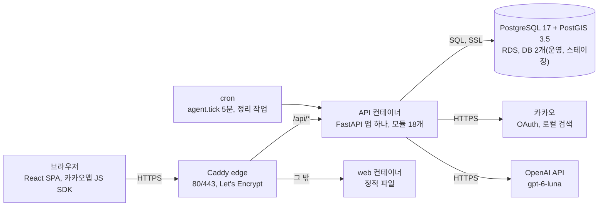
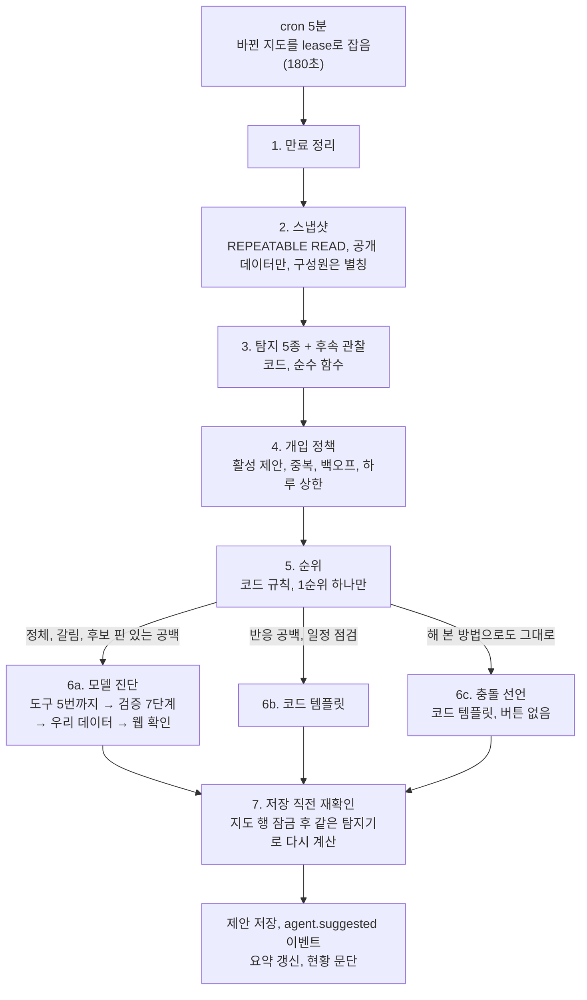
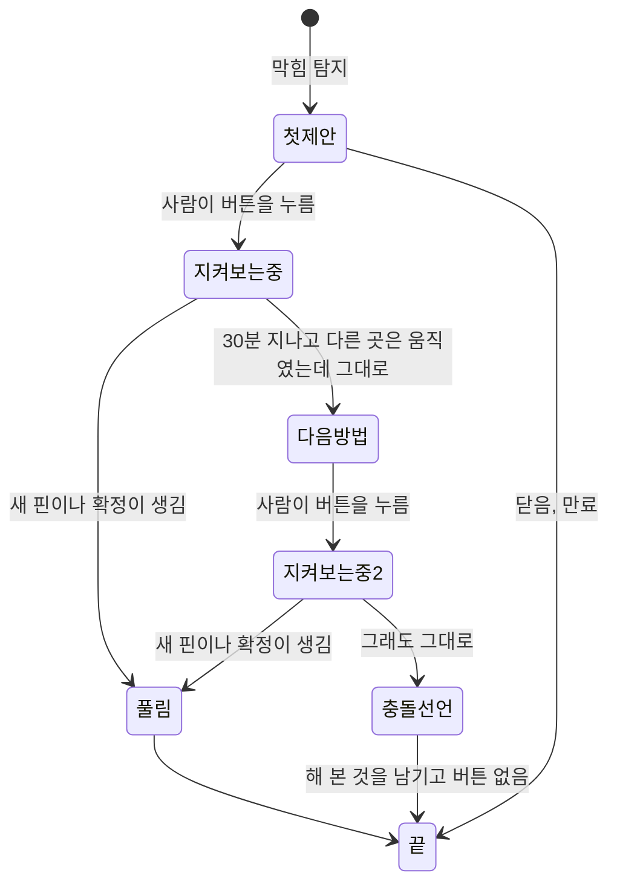
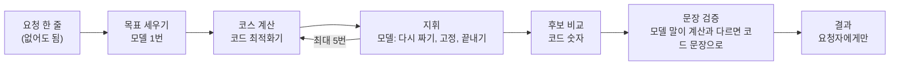
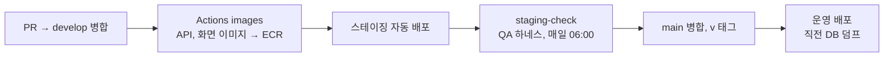

# 핑고핑고 기술 명세서 (최종)

작성 기준은 `develop` 브랜치의 커밋 `ee385500`(2026-11-05)입니다. 이 문서는 제출용 요약본이고, 각 항목의 정본은 괄호 안에 적은 파일입니다. 숫자는 그 시점에 저장소와 스테이징에서 직접 센 값이고, 확인하지 못한 것은 확인하지 못했다고 적었습니다.

정본 문서의 위치는 다음과 같습니다.

- 제품 스펙: `최종기획안.md`
- 기술 계약: `docs/` (API는 `docs/api-spec.yaml`, DB는 `docs/data-model.md`, 조건 표는 `docs/constraints.md`, 권한은 `docs/permissions.md`, 이벤트는 `docs/events.md`, 오류 코드는 `docs/errors.md`)
- 에이전트 명세: `docs/agent-v2.md`
- 배포 절차와 결정: `deploy_rules.md`
- 품질 점검 기록: `qa/`

---

## 0. 개요

### 0.1 풀려는 문제

친구 3~5명이 여행 장소를 정할 때, 장소를 모으는 일은 지도 앱으로 됩니다. 막히는 곳은 그다음입니다. 누가 "거기 별로야"라고 말한 뒤 아무도 다음 후보를 내지 않으면 결정이 멈추고, 멈춘 대화는 단톡방 잡담에 묻힙니다.

핑고핑고는 이 멈춤을 푸는 서비스입니다. 친구들이 지도 하나에 핀을 찍고 핀마다 좋음(♥)이나 반대(🚫)를 남깁니다. 반대에는 반드시 이유를 적게 하고, 그 이유를 조건으로 바꿔 대안 장소를 찾습니다. 사람이 확정한 장소는 확정 리스트와 날짜별 일정으로 남습니다.

타깃은 방학마다 3~5명이 함께 여행을 가는 대학생입니다(`최종기획안.md` 1절).

### 0.2 기능 범위

v1(핵심 흐름)은 카카오 로그인, 공동 지도와 초대, 핀과 반응(사유 칩과 140자 글), 실시간 동기화, AI 추천(사유를 조건으로 바꿔 대안 3곳), 근거 고치기와 다시 추천, "지도에 올리기", 확정 리스트, 날짜별 일정과 동선 보기입니다.

v2(구현됨)는 계획 보조 에이전트 (핑고 AI 조언), 동선 에이전트 (AI 코스 짜기), 카카오톡 대화 내보내기로 핀 한꺼번에 찍기, 게스트 참여, 크레딧과 장소 후기, 추천 탭 광고, 서울 밖 5개 도시 장소 데이터입니다.

범위 밖으로 정한 것(요청받아도 만들지 않는 것)은 항공과 숙박 예약, 경비 정산, 자체 채팅, 시간 배정, AI의 최종 장소 결정입니다(`최종기획안.md` 11절).

---

## 1. 아키텍처 설계

### 1.1 전체 구조



구성 요소마다 맡은 일은 다음과 같습니다.

- 브라우저는 모바일 우선 SPA입니다. 지도는 카카오맵 JS SDK로 그리고, API는 `src/api.ts` 한 곳에서 부릅니다.
- Caddy가 `/api/*`는 API 컨테이너로, 나머지는 정적 파일 컨테이너로 보냅니다. SSE가 막히지 않게 바로 흘려보내도록 설정했습니다(`deploy/Caddyfile`).
- API는 마이크로서비스가 아니라 FastAPI 앱 하나입니다. 서버 1대와 작은 팀에 맞춘 선택이고, 모듈 경계는 import 규칙 검사로 지킵니다(1.2절).
- DB는 PostgreSQL 하나로 데이터, 세션 무효화, 멱등키, 이벤트 로그를 모두 다룹니다. Redis는 쓰지 않습니다.
- 백그라운드 작업은 서버 cron이 API 컨테이너 안에서 명령으로 돌립니다(에이전트 관찰 5분마다, 정리 작업 하루 한 번).

### 1.2 백엔드 모듈 구조

모듈은 18개입니다(`backend/pyproject.toml`의 `root_packages`).

- 수평 층 3개: `common`(설정, DB, 이벤트 기록, 거리 계산, 카테고리), `auth`(사람과 로그인 수단, 세션), `authz`(권한 정책 표)
- 기능 모듈 15개: `maps`, `pins`, `places`, `seeding`, `recommend`, `llm`, `shortlist`, `realtime`, `notifications`, `feedback`, `maintenance`, `ads`, `credits`, `reviews`, `agent`

모듈 사이 규칙은 다음과 같습니다. 이 규칙은 문서가 아니라 검사로 지킵니다.

1. 다른 모듈은 그 모듈의 `api.py`와 `schemas.py`만 import합니다. 다른 모듈의 `models.py`나 `service.py`를 직접 읽으면 CI가 실패합니다(`integration/test_import_rules.py`, import-linter 계약).
2. 수평 층(`common`, `auth`, `authz`)은 기능 모듈을 import하지 않습니다. 기능 모듈이 수평 층을 부릅니다.
3. 다른 모듈 테이블을 가리키는 열은 문자열이고 DB 외래키를 걸지 않습니다. 모듈마다 테이블 주인이 하나입니다.

모듈 안은 네 층으로 나눕니다(`docs/architecture.md` 1.1절).

- `router.py`: HTTP 입출력과 권한 확인
- `flows.py`: 기능 하나를 실행하는 순서와 실패 처리(판단은 두지 않음)
- `core.py`: 판단 규칙. 순수 함수이고 DB를 모릅니다
- `service.py`: 자기 테이블 읽기와 쓰기

같은 지도에 대한 동시 쓰기는 지도 행을 잠가 줄을 세웁니다(`maps.api.lock_map_if_alive`). 지도 삭제, 구성원 나가기, 에이전트 제안 저장이 서로 엇갈리지 않게 하려는 장치입니다.

### 1.3 데이터

DB는 PostgreSQL 17과 PostGIS 3.5이고, 운영과 스테이징은 RDS 한 대에 DB를 둘로 나눠 씁니다. 테이블은 41개이고 마이그레이션은 Alembic 단일 체인으로 `0065_recommend_run_radius_m`이 최신입니다. 배포는 마이그레이션을 먼저 올리고 앱을 바꾸므로, 이전 코드가 새 스키마에서도 돌도록 스키마를 늘리는 변경과 줄이는 변경을 나눠 냅니다.

장소 데이터는 세 층입니다(`docs/architecture.md` 2절).

1. 구조화 필드: 인허가, TourAPI 같은 공공데이터에서 온 이름, 주소, 좌표, 면적
2. 반구조화 값: 장소 라벨(`place_facts`). 키마다 참, 거짓, 모름 중 하나입니다. 예를 들어 `parking_available`(주차 가능), `is_crowded_large`(붐비는 대형 카페)
3. 판단 라벨: 데이터 담당이 만든 라벨 파일을 적재한 값. v1에서는 요청 중에 모델로 라벨을 만들지 않습니다

2026-11-04 스테이징 새 DB 적재 실측은 정예 장소 13,855곳(음식점 8,078, 카페 3,738, 관광지 2,039), 전체 장소 199,195곳, 영업시간 12,958행입니다. 2026-11-05에는 시도 경계 17개(통계청 2018)를 `sido_boundaries` 표에 넣어, 지도의 시도 판정과 "반경이 여행 지역 밖으로 나갔는지" 판정을 경계 기준으로 바꿨습니다.

카카오 로컬 검색 응답은 약관에 따라 저장, 캐시, 모델 입력에 쓰지 않습니다. 저장하는 것은 카카오 장소 ID와 `place_url`뿐입니다. 이 규칙은 `integration/test_kakao_no_store_e2e.py`와 `test_places_no_kakao_leak.py`가 검사합니다.

### 1.4 실시간 동기화

상태를 바꾸는 모든 쓰기는 같은 트랜잭션 안에서 `event_log`에 이벤트 한 줄을 남깁니다(`common.events.record_event`). realtime 모듈이 0.5초마다 이 표를 읽어 구독자에게 SSE로 보냅니다. 상태 변경과 이벤트가 한 트랜잭션이라, 커밋된 변경의 이벤트가 빠지는 일이 없습니다.

- 채널은 지도 공개 채널(`/maps/{mapId}/events`)과 개인 채널 둘입니다. 비공개 AI 후보는 공개 채널로 절대 내려가지 않습니다.
- 전달 보장은 최소 한 번이고, 클라이언트는 `seq`로 중복을 거릅니다. 재연결 때 놓친 이벤트를 24시간 안에서 다시 보냅니다.
- 이벤트 종류는 41개입니다(`docs/events.md`).
- 한계: 폴러가 API 프로세스 안에서 돌기 때문에 API 컨테이너 1개를 전제합니다. 폴러가 죽으면 `/health`가 503을 돌려 감시에 잡히게 했습니다(#1200).

### 1.5 AI와 코드의 분담

설계의 출발점은 1차 실측입니다. 챗봇 방식으로 검증 가능한 제약이 걸린 6건을 돌렸더니 6건 모두 실패했고, 그중 둘은 "해산물 못 먹음"에 재첩국과 초밥을 추천한 경우였습니다(`최종기획안.md` 2절). 그래서 한 명이라도 걸리면 안 되는 판단과 계산으로 답이 나오는 일은 코드가 하고, 모델은 정답이 하나가 아닌 일(사람 말 읽기, 막힌 곳 진단, 다음 수 고르기)에만 씁니다.

모델 호출은 7종이고, 모두 `llm/api.py` 한 곳을 지나며 호출마다 `llm_calls` 표에 한 줄을 남깁니다(`backend/llm/models.py`의 `CALLS`).

| 호출 | 언제 | 하는 일 | 상한과 시간 |
|---|---|---|---|
| `plan_evidence` (②) | 사람이 "추천 받기"나 근거 "+"를 누를 때 | 자유서술 사유에 조건 키와 방향을 붙임 | 15초, 재시도 없음 |
| `agent_diagnose` | 백그라운드 관찰 중 | 정체와 갈림의 원인을 도구로 조사하고 제안 문장을 씀 | 도구 5번, 대화 40초, 지도 하루 (구성원 수 × 4)번 |
| `agent_status` | 백그라운드 관찰 중, 지도 상태 칸이 바뀔 때만 | 코드가 계산한 칸을 한 문단으로 이음 | 15초 |
| `agent_web_check` | 백그라운드 관찰 중, 우리 데이터가 모름일 때만 | 웹을 검색해 출처와 함께 짧게 옮김 | 30초, 서비스 하루 3,000원 예산 |
| `course_goals` | 사람이 "AI 코스 짜기"를 누를 때 | 요청 한 줄과 지도 근거를 목표로 바꿈 | 코스 1번에 1번 |
| `course_direct`, `course_turn` | 같은 실행 안 | 코드 최적화를 지휘(다시 짜기, 고정, 끝내기) | 코스 1번에 지휘 최대 5번, 실행 180초 |

모델이 하지 않는 일은 실격 필터, 선호 순위(점수), 반경과 동선 계산, 영업 여부 판정, 카톡 대화 해석, 에이전트의 탐지와 정책과 순위, 추천 막힘 조언입니다. 이 중 선호 순위(#99), 에이전트 신호 순위(#582), 추천 막힘 조언(#749)은 처음에 모델이 하던 일을 평가 결과를 보고 코드로 옮긴 것입니다(4.3절).

사람이 누른 AI 실행("추천 받기", "AI 코스 짜기")은 크레딧 1을 씁니다. 정식 계정은 30으로 시작하고, 모델이 실패하면 차감하지 않거나 돌려줍니다(`docs/credits-reviews.md`).

### 1.6 에이전트 설계

에이전트는 세 가지입니다. 시작하는 주체와 자율의 범위가 서로 다릅니다.

| 에이전트 | 시작 | 모델이 고르는 것 | 사람이 끼는 곳 |
|---|---|---|---|
| AI 추천 루프 | 사람이 누름 | 사유마다 조건 키와 방향 | 실행, 근거 고치기, "지도에 올리기" |
| 핑고 AI 조언 | 서버가 5분마다 스스로 관찰 | 막힌 곳을 어떻게 읽을지, 어떤 도구로 무엇을 볼지, 말할지 침묵할지 | 제안의 버튼을 누르거나 닫음 |
| AI 코스 짜기 | 사람이 누름 | 목표, 턴마다 다음 수 | 실행만. 되묻지 않고 끝까지 감 |

#### 1.6.1 AI 추천 루프

| 단계 | 담당 | 하는 일 |
|---|---|---|
| ⓪ 준비 | 코드 | 카테고리별로 의견 달린 핀이 1개 이상인지 판정 |
| 실행 요청 | 사람 | "추천 받기", 크레딧 1 |
| ① 인식 | 코드 | 핀, 반응, 사유, 제외 목록, 기준 좌표 수집 |
| ② 계획 | 모델 | 자유서술 사유에 조건 키와 방향을 붙임. 칩은 모델을 거치지 않음 |
| ③-a 실격 필터 | 코드 | 반경 밖 → 영업 종료 → 실격 조건 → 이미 제안하거나 거절한 곳 순서로 제거 |
| ③-b 선호 순위 | 코드 | 통과한 후보만 라벨 대조 점수로 상위 3곳 |
| ④ 반영 | 코드 | 이유, 조건별 충족, 구성원 충족 집계, 출처를 붙여 점선 핀으로 요청자에게만 표시 |
| 근거 고치기 | 사람 | 결과 화면에서 내 근거를 빼거나 더하고 다시 추천 |
| ⑤ 게시 | 사람 | "지도에 올리기"를 눌러야 다른 구성원에게 보임 |

상태는 run 한 건(`collecting_evidence`, `awaiting_region_confirm`, `executing`, `done`, `failed`)과 그 run의 근거 줄입니다. 화면에 깔때기 표를 보여 단계마다 몇 곳이 빠졌는지 밝힙니다. 지도에 오른 후보와 다시 추천으로 빠진 후보는 제외 목록에 들어가 다음 실행의 입력이 됩니다.

예외 처리는 다음과 같습니다.

- 모델 호출이 실패하면 run을 실패로 끝내고 크레딧을 쓰지 않습니다(차감이 모델 호출 뒤입니다).
- 결과가 0곳이면 0곳으로 보여 주고 크레딧을 돌려줍니다(#1015). 화면은 깔때기와 함께 반경 넓히기와 카카오맵 검색 링크를 냅니다.
- 다시 추천은 개인당 10번, 반경 넓히기는 도보 30분까지가 상한이고 넘으면 정해진 오류 코드(429, 409)로 막습니다.
- 사유 해석에 키가 붙지 않은 줄은 후보를 거르지 않고, "이 조건으로 찾았어요"에 "반영하지 못한 이유"와 함께 보입니다.

#### 1.6.2 계획 보조 에이전트 (핑고 AI 조언)

아무도 부르지 않아도 서버가 5분마다 지도를 살펴 결정이 막힌 곳을 찾고, 구성원 모두에게 버튼 하나가 달린 제안을 냅니다. 에이전트는 아무것도 직접 실행하지 않습니다. 버튼은 사람이 원래 하던 동작(추천 받기, 장소 검색, 핀 보기, AI 코스)의 지름길입니다(`docs/agent-v2.md`).

관찰 한 번의 단계는 다음과 같습니다.



탐지하는 막힘은 다섯 종류입니다.

| 종류 | 탐지 조건 | 제안을 만드는 쪽 | 버튼 |
|---|---|---|---|
| 반대 후 정체 | 🚫 뒤로 그 카테고리에 새 핀, 추천, 확정이 없고 다른 카테고리에서 2명이 움직였거나 기준 시간이 지남 | 모델 진단 | 추천 받기(미리 센 수가 0곳이면 장소 검색) |
| 의견 갈림 | 한 핀에 ♥와 🚫가 함께 있고 모두 반응했거나 기준 시간이 지남 | 모델 진단(충돌 종류는 코드) | 추천 받기 또는 장소 검색 |
| 카테고리 공백 | 확정 2곳 이상인데 확정 리스트에 그 카테고리가 없음 | 후보 핀이 있으면 모델, 없으면 코드 | 이 핀 보기 또는 추천 받기 |
| 반응 공백 | 구성원이 기준 시간 넘은 핀의 절반 넘게 반응하지 않음 | 코드 | 미확인 핀 보기 |
| 일정 점검 | 확정 일정에 쉬는 날 방문이나 이동 과다 | 코드(AI 코스 점검과 같은 함수) | AI 코스로 고쳐 보기 |

기준 시간은 지도의 활동 리듬(최근 행동 간격의 중앙값 × 3)에 출발까지 남은 날에 따른 계수를 곱하고 1~12시간으로 자른 값입니다.

진단 모델이 쓸 수 있는 도구는 모두 읽기 전용이고, 다른 모듈의 `api.py`를 감싸기만 합니다.

| 도구 | 반환 | 쓰는 유형 |
|---|---|---|
| `get_reasons` | 사유 글과 칩, 구성원 별칭 | 정체, 갈림, 공백 |
| `structure_reasons` | 사유의 조건 키와 방향(② 재사용, 캐시) | 정체, 갈림 |
| `compare_reasons` | ♥ 쪽과 🚫 쪽 조건 비교와 충돌 종류 | 갈림 |
| `get_reaction_matrix` | 구성원별 반응 표 | 갈림 |
| `get_place_facts` | 이 지도 핀 장소의 라벨 | 갈림 |
| `get_readiness` | 추천 준비 여부 | 정체, 공백 |
| `get_map_overview` | 카테고리별 핀과 확정 수 | 정체 |
| `try_in_schedule` | 미확정 핀을 확정 일정에 끼워 본 결과(AI 코스 엔진) | 갈림, 공백 |

진단 전에 코드가 직접 부르는 것도 있습니다. "추천 받기"를 권하기 전에 추천 필터를 읽기 전용으로 돌려 실제로 남는 곳을 미리 셉니다(`recommend.api.preview_filter`). 0곳이면 "추천 받기" 버튼을 빼서 헛되이 크레딧을 쓰지 않게 합니다. 같은 도구를 같은 인자로 다시 부르면 실행하지 않고 처음 결과를 가리킵니다(#1310).

모델 출력은 그대로 화면에 나가지 않습니다. 모델은 숫자와 인용을 문장에 직접 쓰지 않고 claim(검증할 수 있는 사실 하나)으로 내며, 코드가 다음 7단계로 검증한 뒤 서버가 문장을 조립합니다.

1. 스키마 검증. 실패하면 다시 묻지 않고 침묵합니다
2. 진단이 이번 관찰의 1순위 신호와 같은지
3. claim 대조: 개수는 스냅샷으로 다시 세고, 인용은 원문 범위와 대조하고, 도구 값은 그 호출 기록과 대조합니다
4. 요약 구조: 알러지 사유에 "더 적어 달라"를 붙이지 않았는지
5. 문장: 슬롯 밖 숫자, 구성원 이름과 별칭, 결정 지시 표현("확정하세요"), 사유 원문 옮겨 쓰기를 뺍니다
6. 버튼: 허용 목록, 0곳이면 추천 받기 빼기, 🚫 달린 핀은 이 핀 보기 빼기. 버튼의 근거는 코드가 관찰 기록으로 채웁니다(#1380)
7. 필수 claim과 문장 또는 버튼이 남았는지. 아니면 침묵합니다

구성원이 쓴 사유 글은 에이전트 문장과 섞지 않고 인용 조각으로 따로 내립니다(#717). 그래서 사유 안에 "이 핀으로 확정하세요" 같은 지시가 있어도 에이전트의 말이 되지 않습니다.

상태는 agent 모듈의 표 8개에 둡니다.

| 표 | 담는 것 |
|---|---|
| `agent_cursors` | 지도별로 본 이벤트 번호, 다음 관찰 시각, lease(동시 관찰 방지) |
| `agent_runs` | 관찰 1건(신호, 정책 결과, 순위, 도구 기록, 검증 기록, 결과 종류, 토큰) |
| `agent_suggestions` | 제안(상태, 후속 단계 `attempt`, 해 본 버튼, 24시간 안 확정 여부) |
| `agent_settings`, `agent_suggestion_views` | 모드 켜기와 끄기, 사람별 열람 |
| `agent_reason_summaries`, `agent_map_status`, `agent_run_advice` | 우리 조건 요약, 지도 현황 문단, 추천 막힘 조언 |

사유 원문은 agent 표에 저장하지 않고 반응 id로만 가리킵니다. 반응이 지워지면(탈퇴, 지도 나가기) 인용도 저절로 사라집니다.

수락한 제안은 그 막힌 곳이 풀릴 때까지 지켜봅니다(#1345).



풀렸는지와 그대로인지는 코드가 관찰마다 판정하고 모델을 부르지 않습니다. 다음 방법은 진단을 다시 부르되 이미 해 본 버튼은 허용 목록에서 뺍니다. 충돌 선언은 해 본 것과 지금 조건으로 미리 센 수만 쓰고, 조건을 완화하자는 말은 금지 표현으로 막습니다(가드레일 4, 10).

예외 처리는 다음과 같습니다.

| 상황 | 처리 | 사용자에게 보이는 것 |
|---|---|---|
| 모델 호출 실패, 시간 초과, 스키마 실패 | 다시 묻지 않고 그 관찰은 제안 없이 기록(`model_failed`, `invalid_schema`) | "이번에는 지도를 끝까지 살펴보지 못했어요. 새 활동이 생기면 다시 볼게요" |
| 검증 탈락 | 저장하지 않음(`invalid_claims`) | "핑고가 쓴 제안이 확인을 통과하지 못해 내보내지 않았어요" |
| 저장 직전 지도가 바뀜 | 버리고 다음 관찰에서 새로 판단(`stale`) | 없음 |
| 지도 하루 상한 도달 | 모델 유형만 막고 코드 유형은 통과 | "오늘은 자세히 살펴보는 횟수를 다 썼어요" |
| 관찰이 예외로 끝남 | 단계와 예외 이름만 기록, 30분, 2시간, 6시간 간격으로 다시 봄 | 없음 |
| 서비스 하루 예산(3,000원) 초과 | 웹 확인만 쉼, 제안은 그대로 | "오늘은 웹 확인을 쉬고 있어요" |
| 한 번에 처리할 지도가 많음 | tick당 6곳, 150초가 지나면 남은 지도는 다음 tick으로 | 없음 |

제안이 없는 이유와 실패를 화면에서 구분해 보이고, 시트에 "핑고가 12분 전에 지도를 살펴봤어요"를 띄워 관찰이 돌고 있음을 보여 줍니다(#1297). 제안마다 "핑고가 한 일"을 펼치면 감지, 조사, 미리 찾기, 우리 데이터, 웹 확인, 검증, 재확인 단계가 줄마다 AI인지 코드인지와 함께 나옵니다.

#### 1.6.3 동선 에이전트 (AI 코스 짜기)

확정 리스트의 장소를 여행 날짜별 순서와 이동 시간으로 짭니다. 시간 배정은 하지 않습니다.



- 모델이 고르는 것: 요청 한 줄을 목표로 바꾸기, 턴마다 다음 수(다시 최적화, 장소 고정, 끝내기)와 후보 가운데 어느 쪽을 고를지
- 요청에 없어도 우리 조건 요약과 확정 장소의 라벨로 지도 목표를 세웁니다. 이 목표에는 "(지도에서 세운 목표)"와 근거를 붙입니다
- 코드가 하는 것: 코스 계산, 휴무와 도보 판정, 쉬는 날과 이동이 넘치는 날을 옮겨 보고 견주기, 화면 문장 검증
- 상태: 불변 상태 값(코스, 위반, 후보, 고정)을 턴마다 새로 만들고 대화 기록을 쌓지 않습니다. run은 대기 → 실행 → 끝이고, 작업 기록은 DB에 남습니다
- 되묻지 않습니다(#1131). 모르는 영업시간은 "가게에 확인해 주세요" 가정 줄로 남기고 끝까지 갑니다
- 결과는 요청자에게만 보이고 확정 리스트와 일정을 바꾸지 않습니다. 일정에 넣을지는 사람이 정합니다

예외 처리는 이렇습니다. 모델이 시간 초과, 형식 오류, 응답 없음이면 그 턴은 코드 규칙(기준선)이 이어받고 작업 기록에 원인을 적습니다. 쓸 수 없는 턴이 연속 2번이면 나머지는 기준선이 끝까지 갑니다. 그래서 모델이 실패해도 코스는 나옵니다. 실행 전체 상한은 180초이고, 서버가 재시작되어 끊긴 실행은 기동 때 실패로 정리하고 크레딧을 돌려줍니다.

### 1.7 기술 스택

| 영역 | 선택 |
|---|---|
| 백엔드 | Python 3.12, FastAPI 0.115, SQLAlchemy 2.0, Alembic 1.13, Pydantic 2.9, GeoAlchemy2, httpx |
| DB | PostgreSQL 17, PostGIS 3.5, pg_trgm(장소 이름 검색) |
| LLM | OpenAI API 직접 호출, `gpt-6-luna`, Pydantic 구조화 출력, 웹 확인만 Responses API의 웹 검색 |
| 프론트엔드 | React 19, TypeScript 6, Vite 8, Tailwind CSS 4, TanStack Query 5(서버 상태), Zustand 5(화면 상태), React Router 8, 카카오맵 JS SDK |
| 계약 | OpenAPI 3.1(`docs/api-spec.yaml`), openapi-typescript로 FE 타입 생성, msw 목 서버 |
| 테스트 | pytest(실제 PostgreSQL), Vitest와 Testing Library, Playwright(E2E), import-linter |
| 인프라 | AWS EC2 1대, RDS, ECR, Docker Compose, Caddy, GitHub Actions(OIDC) |

### 1.8 배포 구성



- 서버 1대에서 운영과 스테이징을 컨테이너, DB, 비밀값으로 나눕니다. 주소는 `ktc-pingopingo.duckdns.org`와 `staging.ktc-pingopingo.duckdns.org`이고 인증서는 Caddy가 받습니다.
- 배포 스크립트(`deploy/deploy.sh`)는 이미지 받기 → (운영이면) DB 덤프 → 마이그레이션 → 컨테이너 교체 → 90초 건강 확인 순서이고, 실패하면 이전 태그로 자동 롤백합니다. 같은 환경의 동시 배포는 파일 잠금으로 막습니다.
- 서버 접속은 SSM만 쓰고 22번 포트는 닫혀 있습니다. 비밀값은 서버의 `deploy/env/*.env`(권한 600)에만 있고 저장소에는 이름만 있습니다.
- 감시는 GitHub Actions `uptime`이 10분마다 서버 밖에서 운영과 스테이징의 `/`와 `/api/health`를 확인하고, 실패하면 경보 이슈를 열고 회복하면 닫습니다.
- 운영은 2026-10-30 이미지에 머물러 있고, 크레딧, AI 코스, 핑고 AI 조언의 최근 변경은 스테이징에만 있습니다. 운영 릴리스는 2026-11-20 전에 정하기로 했습니다.

---

## 2. 시나리오

### 2.1 사용자 흐름

방장은 카카오로 로그인해 지도를 만들고(제목, 시도, 여행 날짜) 초대 링크를 단톡방에 보냅니다. 구성원은 링크 하나로 들어오고, 로그인하지 않은 게스트로도 참여할 수 있습니다. 모두 장소를 검색해 핀을 찍거나, 카카오톡 대화 내보내기 파일을 넣어 대화 속 장소를 한꺼번에 핀으로 만듭니다.

핀마다 ♥ 또는 🚫를 남깁니다. 🚫는 칩(예: 너무 붐벼요)이나 140자 글로 이유를 적어야 등록됩니다. 의견이 쌓이면 "추천 받기"가 켜지고, 결과 3곳이 요청한 사람에게만 점선 핀으로 뜹니다. 마음에 들면 "지도에 올리기"로 모두에게 공개하고, 다 같이 ♥를 남긴 뒤 확정 리스트에 넣습니다. 확정 탭에서 날짜와 순서를 정하고 동선을 봅니다.

### 2.2 대표 장면: 멈춘 결정이 풀리기까지

친구 셋(지우, 서연, 민재)의 성수 여행을 예로 듭니다. 각 단계에 화면과 서버가 하는 일을 함께 적었습니다.

1. 서연이 큰 카페 핀에 🚫와 칩 "너무 붐벼요", 글 "주말엔 자리 잡기도 힘들어요"를 남깁니다. 서버는 반응을 저장하고 `reaction.changed` 이벤트로 세 화면을 동시에 갱신합니다.
2. 그 뒤 지우와 민재는 음식점 핀에만 ♥를 누릅니다. 카페는 반대 뒤로 멈춘 상태가 됩니다.
3. 아무도 부르지 않았는데, 다음 관찰(5분 안)에서 핑고가 반대 후 정체를 찾습니다. 세 화면의 "핑고 AI 조언" 버튼에 점이 켜집니다.
4. 지우가 시트를 엽니다. "카페 후보가 반대 의견 뒤로 멈춰 있어요", 서연의 사유 인용, "지금 조건으로 찾으면 맞는 곳이 12곳 있어요", 우리 데이터 줄(그 카페가 붐비는 대형 카페인지 모름)과 출처가 달린 웹 요약("확인 안 됨" 표시)이 보입니다. "핑고가 한 일"에는 감지(코드), 조사(AI), 미리 찾기(코드), 웹 확인(AI, 출처는 코드가 대조), 검증(코드), 재확인(코드)이 나옵니다.
5. 지우가 "카페 추천 받기"를 누릅니다. 서버는 제안을 수락으로 바꾸고 동작만 돌려주며, 화면이 손으로 누를 때와 같은 추천 API를 부릅니다. 서연의 "너무 붐벼요"가 "붐비는 대형 카페 제외" 조건이 되고, 깔때기에 "실격 조건 제거 −3곳"이 보입니다.
6. 대안 카드에는 이유, 조건별 충족(붐비는 대형 카페 아님 ✓), 구성원 충족 3/3, 출처가 붙습니다. 지우가 "지도에 올리기"를 누르면 서연과 민재 화면에 실시간으로 뜨고, 둘의 ♥로 확정됩니다.
7. 다음 관찰에서 핑고의 "지켜보는 곳"이 "카페, 풀렸어요, 새 핀이 올라왔어요"로 바뀝니다.

아무도 올리지 않았다면 30분 뒤 핑고가 해 본 방법(추천 받기)을 빼고 장소 검색을 권하고, 그래도 그대로면 해 본 것을 남기고 "어떤 조건을 지킬지는 여러분이 정해요"로 결정을 돌려줍니다(1.6.2절).

### 2.3 그 밖의 주요 동작

- 의견 갈림: 한 음식점 핀에 ♥ 2, 🚫 1이고 둘 다 "주차"를 원하는 경우, 핑고는 취향 갈림이 아니라 사실 다툼으로 분류하고 우리 데이터의 주차 라벨을 보여 줍니다. 판정은 하지 않고, 라벨이 거짓이어도 "데이터가 틀릴 수 있어요"를 붙입니다.
- 일정 점검과 AI 코스: 확정 일정에 그날 정기 휴무인 곳이 들어가면 핑고가 "AI 코스로 고쳐 보기"를 냅니다. AI 코스는 요청 한 줄(예: 경복궁이랑 덕수궁은 같은 날 가고 걷는 건 적게)로 목표를 세우고, 1번 안(목표 3개 모두 지킴, 하루 도보 최대 51분)과 2번 안(도보 40분이지만 같은 날 목표를 못 지킴)을 견준 뒤 이유를 남기고 1번 안을 고릅니다(2026-11-03 스테이징 재시험 기록).
- 추천 막힘 조언: 결과가 3곳 미만이면 결과 화면에 "반경 넓히기를 한 번 누르면 4곳이 더 남아요"처럼 시뮬레이션한 수와 버튼을 냅니다. 남이 쓴 조건 줄이면 사실만 알리고 버튼을 주지 않습니다(조건을 빼는 것은 그 줄을 쓴 사람만 할 수 있습니다).

---

## 3. 요구사항과 리스크

### 3.1 비기능 요구사항

| 항목 | 기준 | 근거 |
|---|---|---|
| 응답 시간 | 모델 호출 15초, 웹 확인 30초, 진단 대화 40초, AI 코스 실행 180초 상한. 재시도 없음 | `common/settings.py`, `llm/prompts.py`, `agent/course/constants.py` |
| 비용 | 사람이 누른 AI 실행은 크레딧으로 제한, 백그라운드는 지도 하루 (구성원 수 × 4)번과 서비스 하루 3,000원 예산 | `credits/constants.py`, `llm.api.web_check` |
| 실시간 | 상태 변경과 이벤트를 한 트랜잭션에 기록, 최소 한 번 전달, 24시간 재전송 | `docs/events.md` |
| 개인정보 | 에이전트 기록에 사유 원문을 저장하지 않음, 모델에는 구성원 이름 대신 별칭, 웹 확인에는 장소 이름과 동네와 특징 이름만 보냄, 로그에서 쿼리 문자열과 초대 토큰 경로를 가림 | `docs/agent-v2.md` 2절, `common/logguard.py` |
| 보안 | HMAC 서명 세션 쿠키(httpOnly, SameSite=lax), 로그아웃과 탈퇴 때 이전 토큰 무효화, 운영 기동 가드(스텁 모드, 기본 비밀값, CORS 와일드카드면 서버가 뜨지 않음) | `auth/`, `common/settings.py` |
| 권한 | 역할 → 범위와 행동의 선언적 정책 표, 비구성원은 404, 구성원이지만 불가하면 403 | `docs/permissions.md`, `authz/` |

### 3.2 가드레일

가드레일 10개는 기획 단계에서 실측 실패를 보고 정했고, 각각 코드의 한 자리에서 강제합니다(`최종기획안.md` 7절).

| 가드레일 | 강제하는 곳 |
|---|---|
| 1. AI는 지도를 바꾸지 않는다 | 추천 후보는 비공개 후보 행이고 공개 채널 이벤트로 내려가지 않음, `POST /candidates/{id}/publish`로만 핀이 됨. 에이전트 버튼은 동작 설명만 돌려줌 |
| 2. AI 핀은 자체 DB 장소만, 0개면 0개 | 후보 풀은 정예 장소 표에서만 조회, 결과 0곳은 오류 코드 `NO_RESULTS`로 그대로 표시 |
| 3. 사유 없는 반대는 등록되지 않는다 | `PUT /pins/{pinId}/reaction`이 🚫에 사유가 없으면 422 |
| 4. 제약을 AI가 완화하지 않는다 | 반경 넓히기는 사람이 누르는 버튼만, 충돌 선언 문장에 완화 표현 금지 목록을 검사 |
| 5. 대안에 이유, 충족 체크, 구성원 집계, 출처 | `Candidate` 스키마의 필수 필드(`reason`, `checks`, `member_fulfillment`) |
| 6. 이미 제안했거나 거절된 장소 제외 | 제외 목록 단계가 깔때기에 있고 몇 곳을 뺐는지 표시 |
| 7. 실격은 코드가 거르고 순위도 코드 | `recommend/core.py`의 필터와 점수 함수, 모델 출력은 키와 방향뿐 |
| 8. 모름은 정책대로, 안전 조건은 판단하지 않음 | `docs/constraints.md`의 `unknown_policy`, 알러지 사유는 거르지 않고 "가게에 직접 확인해 주세요" 안내 |
| 9. 한 명이라도 실격이면 내린다 | 실격 필터가 구성원 한 명의 조건으로도 후보를 뺌, 에이전트는 🚫 달린 핀을 권하지 않음 |
| 10. 충돌 선언은 최후에만, 시도를 남긴다 | 에이전트 후속 관찰(첫 제안 → 다음 방법 → 충돌 선언), 절충안을 먼저 미리 셈 |

### 3.3 장애 대응

| 장애 | 대응 |
|---|---|
| 모델 API 실패, 시간 초과 | 재시도하지 않음. 추천은 크레딧을 쓰지 않고 실패로 끝냄, 에이전트는 침묵하고 다음 관찰에서 다시 봄, AI 코스는 그 턴을 기준선이 이어받음. 모든 호출의 결과 종류가 `llm_calls`에 남음 |
| 모델이 같은 JSON을 두 번 보냄 | 첫 객체만 같은 스키마로 검증해 받음(`ok_repeated_json`, #767) |
| 비용 폭주 | 서비스 하루 예산을 넘으면 웹 확인을 끔, 합계를 읽지 못하면 부르지 않음 |
| 카카오 API 실패 | 검색 실패를 오류 코드로 돌려주고 화면이 안내, 카카오 응답은 저장하지 않으므로 재조회로 회복 |
| 백그라운드 관찰이 겹침 | 지도마다 lease로 한 번에 하나만 관찰, 프로세스가 죽어도 180초 뒤 다른 실행이 가져감 |
| 서버 재시작으로 끊긴 AI 코스 | 기동 때 실패로 정리하고 크레딧 환불 |
| SSE 폴러 정지 | `/health`가 503, 외부 감시(`uptime`)가 경보 이슈를 엶 |
| 배포 실패 | 90초 건강 확인 실패 시 이전 태그로 자동 롤백, 운영은 배포 직전 DB 덤프 |

### 3.4 남은 리스크

확인한 사실 기준으로 아직 남은 것들입니다.

- 인프라가 서버 1대이고 SSE 폴러가 프로세스 안에서 돌아, API를 여러 대로 늘리려면 구조를 바꿔야 합니다. 부트캠프 AWS가 2026-11-20에 끝나 그 뒤 인프라는 정해지지 않았습니다(#1203).
- 백업 복원을 별도 환경에서 검증한 적이 아직 없습니다(#1204).
- 갈림 제안의 "두 의견을 다 맞추는 곳 N곳"은 ♥ 쪽 조건만 세고 🚫 쪽은 필터가 이미 걸렀다고 가정합니다. #1253 이후 🚫 사유 속 원함 조건 대부분이 점수만 바꾸므로, 이 수가 실제보다 많게 나올 수 있는 것으로 보입니다. 고칠지 정하지 않았습니다.
- 에이전트 평가셋은 38개 상황 × 5번이고, 기획안 기준(지표마다 60~100건)으로 보면 아직 작습니다. 운영 기록(`agent_runs`)으로 보완할 계획입니다.
- 후속 관찰과 AI 기능 엮기의 화면 점검(QA G07~G11)은 아직 실행 전입니다.

---

## 4. 테스트 전략

### 4.1 코드 테스트

| 층 | 규모 | 무엇을 보나 |
|---|---|---|
| 백엔드 단위와 모듈 | 테스트 파일 316개, 테스트 함수 4,057개(pytest) | 모듈별 규칙, 순수 함수(core), 흐름(flows)과 실패 경로 |
| 백엔드 통합과 계약 | `backend/integration/` 37개 파일 | 스펙에 있는 경로가 모두 구현됐는지, 응답이 스펙 스키마와 맞는지, 요청 제약이 스펙과 같은지, 권한 정책 표 일치, 오류 코드 카탈로그 일치, import 규칙, 카카오 응답 비저장, 에이전트 끝단 시나리오 |
| 프론트엔드와 계약 패키지 | Vitest 테스트 케이스 451개(목 서버 smoke 포함) | 화면 동작, 접근성(포커스, 알림 영역), 목 서버가 스펙대로 동작하는지 |
| E2E | Playwright 1개 흐름(브라우저 2개) | 지도 만들기 → 구성원 참여 → 핀 → 🚫 사유 → 추천 받기 → "지도에 올리기", 구성원 화면은 새로고침 없이 실시간으로 확인 |

원칙은 세 가지입니다.

1. DB는 모킹하지 않습니다. 백엔드 테스트는 CI에서도 실제 PostgreSQL과 PostGIS 위에서 돕니다.
2. 계약을 테스트로 묶습니다. `docs/api-spec.yaml`이 바뀌면 FE 타입 재생성 결과를 CI가 비교하고, 서버 응답이 스펙과 어긋나면 통합 테스트가 실패합니다. 아직 구현하지 않은 경로는 알려진 목록에 한 줄씩 적고, 구현 PR이 그 줄을 지웁니다.
3. 모델은 테스트에서 부르지 않습니다. 고정 응답 스텁과 대본대로 도구를 부르는 가짜 모델로, 모델 바깥의 운영 코드(도구 대화 루프, 검증, 저장)를 그대로 돌립니다.

에이전트 끝단 테스트(`backend/integration/test_agent_e2e.py`)는 세 사람이 반대를 남긴 지도에서 관찰 → 탐지 → 정책 → 도구를 부르는 진단 → 검증 → 저장 직전 재확인 → 이벤트 → 수락까지 실제 API로 돕니다. 가짜는 모델, 사유 구조화, 장소 셋뿐입니다.

CI는 PR마다 백엔드(import 규칙 → 마이그레이션 → pytest), 프론트(oxlint → Vitest → 빌드), 계약(타입 생성 diff → 타입 검사 → 테스트), E2E를 돌립니다. `develop`의 필수 검사는 계약, pytest, 프론트입니다.

### 4.2 배포 환경 점검

- QA 케이스 대장(`qa/cases.yaml`)에 120개가 있고 97개가 통과로 기록돼 있습니다. 나머지는 실행 전이거나 관찰 기록입니다.
- QA 하네스가 실제 HTTP로 스테이징의 핵심 흐름을 돌립니다. 서버 안에서 실행해 비밀값이 서버 밖으로 나오지 않게 했고, 매일 06:00에 자동으로 돕니다(`staging-check`). RDS 이전 직후인 2026-10-30 기록은 PASS 71, FAIL 0입니다.
- 장소 데이터 적재는 해시와 건수로 검증합니다. 예를 들어 시도 경계 로더는 파일 17개의 내용 해시가 화면 정본과 다르면 하나도 쓰지 않고 거절합니다.

### 4.3 AI 응답 품질 점검

모델을 쓰는 곳마다 평가셋을 두고, 실패를 분석해 고친 기록을 남겼습니다. 고친 방법이 지시문 수정에서 끝나지 않고 코드로 옮긴 경우가 여럿입니다.

| 대상 | 평가셋과 방법 | 결과 | 실패를 보고 고친 것 |
|---|---|---|---|
| ② 사유 구조화 | 흔한 문장 40개, 헷갈리는 문장 20개, 같은 문장 20번 반복, 추천 흐름 28번(2026-10-08) | 흔한 문장 40/40, 헷갈리는 문장 16/20, 추천 흐름 7번(25%)이 키 없이 돌아옴 | 키 없는 사실을 입력에서 빼고(#410), 사유 하나에서 조건 여러 개를 내게 함(#419). 2026-11-02 재점검 30문구 30/30 |
| 추천 결과 | 서울 동네별 시나리오 68개를 실제 모델로 실행하고 결과를 판정(1~8차) | 8차: 음식점 fit 48, partial 6, miss 0, 카페 66, 9, 0 | 직접 쓴 선호와 확인된 반대 라벨인 추천 8곳 → 2곳(거짓 감점). 반대 사유의 과차단을 순위 감점으로 바꿈(#1253) |
| 에이전트 진단 | 지도 상태 38개(침묵이 정답 4개, 지시문 섞인 사유 8개) × 5번 = 190번, 운영과 같은 검증을 거친 결과를 셈 | 결정 일치 190/190, 검증 통과 169/170, 지시문이 에이전트 문장에 나간 횟수 0/40, 평균 6.6초, 한 번 0.58원 | 버튼 근거 누락 11건이 모두 모델이 claim을 만들지 않은 것이라 근거를 코드가 채우게 바꿈(#1380). 같은 결과 파일 재검증으로 첫 버튼 일치 179/190 → 190/190 |
| 지도 현황 문단 | 상황 10개 × 5번 = 50번 | 검증 통과 50/50, 상태와 사실 모순 0, 칸 밖 숫자 0 | 출발이 멀 때 "가까운데"라고 쓰는 문제를 칸 문구에서 고침(#1168) |
| 웹 확인 | 실제 가게, 없는 가게, 같은 이름 다른 동네 등 × 3번 | 출처 대조 통과 96%, 없는 가게에서 문장을 만들지 않음 100%, 결론과 권유 표현 0, 한 번 약 25원 | 대기 글이 많은 가게를 못 찾던 문제를 "맞다는 글과 아니라는 글을 모두 옮긴다"로 고침(webcheck-v2) |
| AI 코스 | 평가 지도 24개, 코드 기준선과 비교 | 요청 목표 충족: 코드 기준선 0.14, 에이전트 0.57(사람이 정답 목표를 준 상한 0.66), 확정 위반 0.04, 휴무와 도보 해결률 0.96 | 처음에는 모델이 장소를 직접 옮겼는데 네 번 고쳐도 기준선을 이기지 못해, 계산을 코드로 넘기고 모델은 목표와 지휘만 맡김 |

평가 결과로 모델에서 코드로 옮긴 일은 세 가지입니다.

- 선호 순위(#99): 사유가 키로 정규화된 뒤에는 라벨 대조 산술만 남았습니다.
- 에이전트 신호 순위(#582): 모델이 기본 순서와 다르게 둔 경우가 모두 규칙 셋(출발 임박, 영향 인원, 연속 닫힘)으로 설명됐습니다.
- 추천 막힘 조언(#749): 종류 일치 84/90(93%)이었고, 남은 실패가 모두 정해진 절차를 어긴 것이었습니다.

평가셋의 지도 상태는 모델 없이도 CI에서 매번 검사합니다(`test_eval_cases.py`). 탐지와 정책 규칙이 바뀌어 기대값이 낡으면 모델 평가 전에 여기서 먼저 깨집니다. 실제 모델 평가는 비용이 들어 버전을 바꿀 때마다 손으로 돌리고, 결과를 `docs/agent-v2.md` 21절과 `qa/results/`에 남깁니다.

---

## 5. 추가 지표

AI 품질과 서비스 효과를 재려고 운영 중에 쌓는 값입니다. 계산에 필요한 값은 모두 DB에 쌓이고 있고, 아직 대시보드로 묶지는 않았습니다.

### 5.1 수집하는 값

| 표 | 열 | 쓰는 곳 |
|---|---|---|
| `llm_calls` | 기능, 호출 종류, 결과 종류(`ok`, `ok_repeated_json`, `refusal`, `empty`, `timeout`, `invalid_schema`, `call_failed`), 입력과 출력 토큰, 캐시 토큰, 비용(원), 웹 검색 횟수, 걸린 시간, 지도와 run id | 호출 실패율, 기능별 비용, 일일 예산 |
| `agent_runs` | 관찰 계기, 탐지한 신호, 정책에서 막힌 이유, 순위 기록, 도구 호출 기록(사유 글 대신 글자 수), 검증 단계별 결과, 코드가 채운 버튼 근거 수, 결과 종류, 모델 사용 여부 | 진단 성공률, 검증 탈락 이유, 도구 사용 패턴 |
| `agent_suggestions` | 유형, 상태(활성, 수락, 닫음, 만료, 무효화), 누른 버튼, 후속 단계, 풀림 이유, 24시간 안 확정 여부 | 수락률, 풀림률, 결정 도움 여부 |
| 추천 run과 근거 줄 | 깔때기 단계별 탈락 수, 근거 줄의 키와 방향, 추천에 쓰였는지와 쓰이지 않은 이유, 후보의 게시 여부 | 사유 해석 실패율, 대안 게시율과 채택률 |
| AI 코스 run | 결과 종류, 목표별 지킴 여부, 작업 기록(누가 무엇을), 실패 코드 | 목표 충족률, 기준선 대체율 |

### 5.2 지표

| 지표 | 계산 | 목표 |
|---|---|---|
| 실격 조건 위반율 | 추천 결과 중 구성원의 실격 조건을 어긴 후보 비율 | 0% (1차 실측 40%) |
| 사유 해석 정확도 | 정답을 단 사유 문장에 ②가 맞는 키와 방향을 붙인 비율 | 90% 이상 |
| 사유 해석 실패율(운영) | 근거 줄 중 키가 붙지 않아 추천에 쓰이지 않은 줄의 비율(`not_enforced_reason = no_key`) | 추세 관찰 |
| 대안 게시율 | 비공개 후보 중 "지도에 올리기"까지 간 비율 | 50% 이상 |
| 대안 채택률 | 지도에 오른 대안이 확정까지 간 비율 | 60% 이상 |
| 24시간 내 결정 비율 | 에이전트 제안 뒤 24시간 안에 그 카테고리가 확정된 비율(`decided_within_24h`) | 70% 이상 |
| 제안 수락률, 풀림률 | 제안 중 버튼을 누른 비율, 수락한 막힌 곳 중 풀린 비율, 충돌 선언까지 간 수 | 추세 관찰 |
| 진단 성공률 | 모델을 부른 관찰 중 제안이 저장된 비율, 실패와 검증 탈락의 비율 | 추세 관찰 |
| 모델 호출 실패율 | `llm_calls` 중 결과가 `ok`가 아닌 비율, 호출 종류별 | 추세 관찰 |
| AI 비용 | 하루 합계와 기능별 합계(원) | 하루 3,000원 안 |
| 같은 장소 반복 추천 비율 | 다시 추천에서 이미 보인 장소가 다시 나온 비율 | 20% 이하 |
| AI 코스 목표 충족률 | 코스 결과의 목표 중 지킨 비율 | 평가 0.57 이상 유지 |

지표마다 시험이 60~100개는 돼야 목표를 넘었다고 말할 수 있다고 보고 있습니다(60개를 돌려 한 번도 틀리지 않아야 실패율 5% 이하라고 볼 수 있습니다, `최종기획안.md` 10절).

---

## 6. 인터페이스 명세

### 6.1 공통 규약

- 정본은 `docs/api-spec.yaml`(OpenAPI 3.1)이고 경로 72개, 오퍼레이션 88개, 스키마 146개, 태그 14개입니다. 프론트 타입과 목 서버는 이 파일에서 만듭니다.
- 기본 주소는 `https://<도메인>/api`이고, 인증은 쿠키 `session`(httpOnly)입니다.
- 오류는 모두 같은 봉투로 돌려줍니다. 화면은 HTTP 상태가 아니라 `code`로 분기하고, 상한 같은 정책 값은 `detail`로 내려 화면에 숫자를 적지 않습니다.

```json
{ "code": "EVIDENCE_LIMIT", "message": "직접 추가는 10개까지예요", "detail": { "limit": 10, "used": 10 } }
```

위 예는 근거 확인 화면에서 "+"로 직접 추가한 글이 run 하나에 10개를 넘을 때(409)입니다.

- 오류 코드는 46개이고 `docs/errors.md`와 `common/errors.py`가 같은지를 테스트가 확인합니다.
- 실시간은 `GET /maps/{mapId}/events`(공개 채널)와 `GET /maps/{mapId}/events/me`(개인 채널)의 SSE이고 이벤트 종류는 41개입니다.
- 권한 실패는 비구성원이면 404, 구성원이지만 그 행동을 할 수 없으면 403입니다.

### 6.2 주요 엔드포인트

| 흐름 | 요청 | 요청 본문 | 응답 |
|---|---|---|---|
| 로그인 | `GET /auth/kakao/login` | 없음 | 302, 카카오 인가 화면 |
| 지도 만들기 | `POST /maps` | `MapCreateRequest` (title, start_date, end_date, region) | 201 `Map` |
| 핀 찍기 | `POST /maps/{mapId}/pins` | `PinCreateRequest` (검색 결과 장소 또는 실시간 핀) | 201 `Pin`, 409 중복 |
| 반응 | `PUT /pins/{pinId}/reaction` | `ReactionRequest` (type, reason_text, reason_chip_ids) | 200 `Reaction`, 422 사유 없는 반대 |
| 추천 준비 | `GET /maps/{mapId}/recommend/readiness` | 없음 | 200 카테고리별 준비 여부 |
| 추천 실행 | `POST /maps/{mapId}/runs` | category, center, execute, radius_m | 202 `RecommendRun`, 402 크레딧 부족 |
| 추천 결과 | `GET /runs/{runId}/result` | 없음 | 200 `RecommendResult`, 404 `NO_RESULTS` |
| 근거 고치기 | `PATCH /runs/{runId}/evidence` | `EvidencePatchRequest` (빼기 또는 더하기) | 200 `EvidenceLine` 목록 |
| 지도에 올리기 | `POST /candidates/{candidateId}/publish` | 없음 | 200 `Pin` |
| 확정 | `POST /maps/{mapId}/shortlist` | pin_id | 201 `ShortlistItem` |
| 추천 막힘 조언 | `GET /runs/{runId}/advice` | 없음 | 200 `RunAdvice`, 204 대상 아님, 500 계산 실패 |
| 핑고 AI 조언 상태 | `GET /maps/{mapId}/agent` | 없음 | 200 `AgentState` |
| 제안 버튼 누르기 | `POST /agent/suggestions/{suggestionId}/accept` | `AgentAcceptRequest` (action_index) | 200 `AgentAcceptResponse`, 409 이미 처리됨 |
| AI 코스 요청 | `POST /maps/{mapId}/courses` | `CourseRequest` (request_text, member_constraints) | 202 `CourseRunCreated`, 402 크레딧 부족, 409 이미 짜는 중 |
| AI 코스 조회 | `GET /course-runs/{runId}` | 없음 | 200 `CourseRun` (요청자 본인만) |
| 실시간 | `GET /maps/{mapId}/events` | 없음 | 200 `text/event-stream` |

### 6.3 요청과 응답 예

반응 등록입니다. 🚫는 `reason_text`나 `reason_chip_ids` 중 하나가 있어야 합니다.

```http
PUT /api/pins/pin_3/reaction
Content-Type: application/json

{ "type": "against", "reason_chip_ids": ["cafe_crowded"], "reason_text": "주말엔 자리 잡기도 힘들어요" }
```

```json
{ "pin_id": "pin_3", "user_id": "u_2", "type": "against",
  "reason_text": "주말엔 자리 잡기도 힘들어요", "reason_chip_ids": ["cafe_crowded"], "display_name": "서연" }
```

추천 결과입니다. 필수 필드는 `run_id`, `funnel`, `regions`, `candidates`이고, 후보마다 `reason`, `checks`, `member_fulfillment`가 필수입니다(가드레일 5).

```json
{
  "run_id": "run_8f2c",
  "funnel": [
    { "key": "pool", "label": "카테고리 후보 풀", "removed_count": 0 },
    { "key": "radius", "label": "반경 밖 제거", "removed_count": 3 },
    { "key": "closed", "label": "영업 종료 제거", "removed_count": 1 },
    { "key": "disqualify", "label": "실격 조건 제거", "removed_count": 3 },
    { "key": "excluded", "label": "이미 제안·거절됨", "removed_count": 1 }
  ],
  "regions": [{ "id": "region_1", "label": "성수 권역", "confirmed": true }],
  "candidates": [{
    "id": "cand_1", "rank": 1, "place_name": "숲길 로스터리",
    "reason": "붐비는 대형 카페를 피하는 조건을 지키고 좌석이 넉넉해요",
    "checks": [{ "fact_key": "is_crowded_large", "label": "붐비는 대형 카페 아님", "passed": true, "confidence": "known", "needs_check": false }],
    "member_fulfillment": { "satisfied": 3, "total": 3 },
    "visibility": "private", "published_pin_id": null,
    "permissions": { "can_publish": true }
  }],
  "applied_evidence": [{ "id": "evi_1", "text": "너무 붐벼요", "badge": "required", "fact_key": "is_crowded_large", "wants": false, "enforced": true }]
}
```

깔때기 라벨 "이미 제안·거절됨"은 서버가 화면에 내리는 문구라 그대로 옮겼습니다. 위 예시의 값(장소 이름, id)은 설명용입니다.

핑고 AI 조언 상태입니다. 문장은 서버가 조각으로 렌더하고(구성원 글은 `quote`, 핀 이름은 `pin`), 화면은 슬롯을 다루지 않습니다.

```json
{
  "settings": { "enabled": true, "updated_by": null, "updated_at": null },
  "has_unseen": true,
  "active_suggestion": {
    "id": "sug_1", "diagnosis": "stall", "category": "카페",
    "title": "카페 후보가 반대 의견 뒤로 멈춰 있어요",
    "advice": [
      { "segments": [{ "kind": "pin", "pin_id": "pin_3", "text": "카페 한라" }, { "kind": "text", "text": " 등에 반대 의견이 1개 남은 뒤로 새 후보가 없어요" }], "is_guess": false },
      { "segments": [{ "kind": "quote", "reaction_id": "r1", "text": "주말엔 자리 잡기도 힘들어요" }, { "kind": "text", "text": " 같은 반대 사유를 조건으로 넣어 새로 추천받아 보면 좋겠어요" }], "is_guess": true }
    ],
    "actions": [{ "index": 0, "type": "open_recommend", "label": "카페 추천 받기", "params": { "category": "카페" } }],
    "steps": [
      { "stage": "감지", "role": "계산", "by": "code", "by_detail": null, "text": "카페에 반대 의견 1개가 남은 뒤로 새 후보가 없어요" },
      { "stage": "조사", "role": "지휘", "by": "ai", "by_detail": null, "text": "반대 사유 1개를 읽었어요" },
      { "stage": "미리 찾기", "role": "계산", "by": "code", "by_detail": null, "text": "지금 조건으로 미리 찾아봤어요 · 12곳 남아요" }
    ],
    "attempt": 0, "tried": [],
    "created_at": "2026-11-05T10:00:00+09:00", "expires_at": "2026-11-06T10:00:00+09:00"
  },
  "summaries": [], "tracking": [],
  "observation": { "checked_at": "2026-11-05T10:00:00+09:00", "notice": null }
}
```

`steps`의 문장 안 가운뎃점은 서버의 고정 문구라 그대로 옮겼습니다.

버튼을 누르면 서버는 아무것도 실행하지 않고 동작만 돌려줍니다. 화면이 그 동작을 손으로 누를 때와 같은 API로 실행합니다.

```http
POST /api/agent/suggestions/sug_1/accept
Content-Type: application/json

{ "action_index": 0 }
```

```json
{ "action": { "index": 0, "type": "open_recommend", "label": "카페 추천 받기", "params": { "category": "카페" } } }
```

AI 코스는 202로 실행 id를 받고, 화면이 `GET /course-runs/{runId}`를 다시 물어 진행 중에는 작업 기록(`steps`)이 늘어나는 것을 보여 줍니다. 끝나면 `status`가 `done`이고 `goals`(목표별 지킴 여부), `days`(날짜별 순서와 이동), `checks`(확인 필요 안내)가 채워집니다.

```json
{ "id": "course_1", "status": "running", "mode": "plan", "outcome": null,
  "steps": [
    { "stage": "이해", "role": "해석", "by": "ai", "by_detail": null, "text": "이렇게 이해했어요: 경복궁과 덕수궁은 같은 날, 하루 걷는 시간 줄이기" },
    { "stage": "짜기", "role": "지휘", "by": "ai", "by_detail": "모델 → 코드", "text": "목표에 맞춰 짜 볼게요" }
  ] }
```

위 응답은 진행 중 모양만 보이려고 필드를 줄였습니다. 실제 응답에는 `CourseRun`의 필수 필드가 모두 들어 있습니다.

---

## 부록. 이 문서의 숫자를 다시 세는 법

- API 규모: `docs/api-spec.yaml`의 `paths`와 `components.schemas`
- 테스트 수: `backend/**/test_*.py`의 `def test_`, `frontend/src`와 `contracts/mocks`와 `e2e/tests`의 `it(`, `test(`
- QA 현황: `qa/cases.yaml`의 `status`
- 평가 수치: `docs/agent-v2.md` 21절, `qa/results/` 날짜별 파일
- 장소 데이터 건수: 스테이징 DB 직접 조회(2026-11-04, 2026-11-05)
